# 描き方: Mermaid と Vega-Lite

パターンを決めたら（SKILL.md の手順6）、ここでそのパターンの描く手段を引きます。各パターンの「例」は、ヘッドレス Chrome（mermaid 11.17、vega-lite 5.23、vega-embed 6.29）で実際に描けることを確かめた最小の例です。例をそのまま出発点にし、データとラベルを差し替えます。

## 描く手段は2つ

| 手段 | どのパターン | 置き方 |
| --- | --- | --- |
| Mermaid | diagram 系の大半（フローチャート、シーケンス図、ER 図、マインドマップ、層図など）と、chart の一部（円、ガント、タイムライン、サンキー） | Markdown の本文に ```` ```mermaid ```` のコードブロックで埋める。GitHub や多くの Wiki がそのまま描く |
| Vega-Lite | chart 系の大半（棒、折れ線、スロープ、散布図、ヒストグラム、箱ひげ、ヒートマップ、地図など） | 仕様（JSON）を `figures/fig-NN.vl.json` に書き、`scripts/vp_figure.py render figures/fig-NN.vl.json --out figures/fig-NN.png` で PNG にする。本文には `` を置く。仕様のファイルは残す |

表は Markdown の表（GFM）です。画像（スクリーンショット・写真）は、実物の素材が要ります。ハーネスは作れません。

忠実度が「近似」のパターンは、カタログの「デザインの文法」のどれかを守れません。何が守れないかは、各パターンの「忠実度」に書いてあります。守れない規則が答えを運ぶのに要るなら、別の候補に切り替えます。「描けない」パターン（chord、contour-map、scaled-cartogram、voronoi、tree-metaphor）は、候補の切替（`index.yaml` の次の候補か `alternatives`）、表、文章にします。

## 共通の決まり

パターン文書の「デザインの文法」と食い違うときは、パターン文書に従います。

- **キャプションは答えの一文。** 図表の直後の段落に「図N: <答え>」と書く。答えの一文を図の `title` に書かない（キャプションと二重になる）。パターン文書が求めるもの（単位・期間・粒度・変化の対象など）は `title` か軸ラベルに書いてよい。
- **注釈は4種類**（taxonomy.md 6.3）。パターンの制約で使える種類に絞り、読み手の慣習にある種類（言語的・色彩的）を先に、意図しない意味を足さない種類を選ぶ。一つの対象に重ねるのは二つまでを目安にする。
  - 言語的: Mermaid は `Note over`・辺のラベル・ノードの文、Vega-Lite は `text` マークで値や名前を対象のそばに置く。凡例との往復をさせない
  - 色彩的: Mermaid は `classDef`・`style`、Vega-Lite は `color` の `condition`。強調の色相は図に一つ、ほかは無彩色か抑えた色。**答えが述べる対象は無彩色にしない**（無彩色の項目は答えの対象外と読まれる）
  - 幾何的: 線の太さ（`strokeWidth`、Mermaid の `linkStyle`）や大きさ。そのパターンの符号化が読ませる長さ・面積・位置を変えない
  - 意匠的: 星印・注目の矢印・枠。符号化に使う記号と見分けがつくときだけ
- **基準線**（平均・目標）は、Vega-Lite では `rule` マークを `layer` で重ね、ラベルを添える。棒にしない。
- **並び順**に意味を持たせる（値の順・時系列・五十音）。並べ替えの基準はキャプションか本文に書く。
- **文字を読まなくても形がわかる**ようにする。文字に依存した図（箱の中の長文、ノードの中の2行目）は落ちやすい。1ノードの文字は短く、説明は本文に。
- **規模**はパターンの `scale` の範囲に収める（`check` が VP050 で照合する）。Mermaid は 40 行を超えたら分割を考える（カタログの規則ではなく、描画上の目安）。

## Mermaid の注意（mermaid 11.17 で確認）

- `cyrus vision` と `vp_figure.py render` は `theme: 'neutral'` で描く。色を付けるなら `classDef` / `style` で明示する（テーマ任せにしない）。
- **日本語のラベル**: flowchart・sequenceDiagram・erDiagram・mindmap・block-beta・timeline・gantt・pie はそのまま書ける。`xychart-beta` の軸のラベルは `"1月"` のように二重引用符で囲む（囲まないと Syntax error）。**`sankey-beta` は ASCII のノード名しか受け付けない**（日本語を含むと Syntax error）。日本語の帯図が要るなら、別の候補（waterfall など）か表にする。
- `erDiagram` の別名構文（`c["顧客"]`）は使えない。実体名をそのまま書く。
- `treemap-beta` の `classDef` 名は2文字以上にする。
- Mermaid の構文エラーは、エラーの文字列を描いた SVG になる。`vp_figure.py render` はこれを検出して失敗にする。描く前に `render` で確かめる。
- オフラインでは、環境変数 `VP_MERMAID_JS`（または cyrus の `CYRUS_MERMAID_JS`）でローカルの mermaid.min.js を、`VP_VEGA_JS`（vega・vega-lite・vega-embed の3つを空白区切り）でローカルの Vega を指定できる。
- flowchart の向きは一方向（`TD` か `LR`）。合流は一本の矢印にまとめる。判断の出口には必ず条件を書く。
- Mermaid の図はソースのまま本文に残るので、拾い読みビュー（outline・pickup）には「［コード・mermaid］」として現れる。要点はキャプションが運ぶ。

## Vega-Lite の注意（vega-lite 5.23 で確認）

- `$schema` は `https://vega.github.io/schema/vega-lite/v5.json`。`background` と `config.font` は `render` が補う（白地、Noto Sans CJK JP）。
- 日本語のラベル・フィールド名はそのまま使える。
- 長さで読ませる軸（棒・面・ヒストグラム・積み上げ・ロリポップの線）はゼロ起点（`scale.zero` を外さない）。位置で読ませる折れ線・散布図・株価チャートはパターン文書の「デザインの文法」に従い、ゼロ以外から始めるなら切った範囲が目盛と軸ラベルでわかるようにする。対数軸が要るなら、そのパターンの「使ってはいけないとき」を確かめる。
- 強調は `color` の `condition`（`{"test": "datum.k == 'B'", "value": "#1f77b4"}` と `"value": "#bbbbbb"`）。系列の数はパターンの `scale.series` に収める。
- 正確な値を読ませるときは `text` マークを重ねる（`layer`）。
- 幅と高さは `width`・`height` で指定する（既定は小さい）。横棒は項目が多いときか項目名が長いとき。
- 地図系（choropleth など）は TopoJSON の地物データが要る。手元にないなら候補から外す（出力媒体の制約）。

## 逆読みに向けて

読み手は、キャプションも本文も見ずに図表だけを読みます（SKILL.md 手順9）。図の中だけで、何に注目すればよいかがわかる形にします。注目点が決まらない図（全項目が同じ色、基準線なし、値の順でない並び）は「どこを見ればよいかわからない」と返ってきます。

## パターンごとの描き方

以下、表と画像、diagram 系、chart 系の順です（各系の中は `index.json` の順）。

## 表と画像

### comparison-table（比較表）
- 描き方: Markdown の表
- 忠実度: 近似 — 失われる規則: 「数値は右揃え、文字は左揃え」。既定の向き（対象を列、観点を行）では、一つの列に数値（500 円）と文字（あり）が混ざる。GFM の揃えは列単位（`:---` / `---:`）だけなので、セルや行ごとには指定できない。対象が多く観点が少ないときに文法が許す転置（対象を行、観点を列）なら、そのまま守れる。
- 注意: 描画エンジンは使わず、GFM のパイプ表（CommonMark + GFM tables 拡張）で書く。GFM にはキャプションの要素がないので、「図から読み取ってほしい答え（どの観点で差が付くか）」の一文は表の直後の段落に「表N: …」の形で書く。○△× を使うときの凡例も文章で添える。特定の対象の列だけに色や太字を付けることは素の GFM ではできないため、「やってはいけないこと」の誘導は構造上起きない。例は 4 列がすべての行でそろい、区切り行が正しいことを確認済み。
- 例:
```markdown
| 観点 | 製品 A | 製品 B | 製品 C |
| --- | --- | --- | --- |
| 価格（月額） | 500 円 | 900 円 | 無料 |
| SSO 対応 | あり | あり | なし |
```

### screenshot（スクリーンショット）
- 描き方: 画像（実物の素材が要る）
- 忠実度: そのまま守れる
- 注意: 本文が述べる状態（同じ設定、同じデータ）の画面を実際に取得した素材が要る。素材は生成できない。埋め込みは素の Markdown の画像で、描画エンジンは使わない。「注目箇所を含む最小の範囲に切り落とす」「注目箇所は一色の枠か矢印で示し、3 箇所まで同じ色と太さにそろえる」「縮小は文字が読める範囲にとどめる」は、素材を整えるときに守る規則で、埋め込みでは守れない。注目箇所の拡大図を添えるなら、別の画像として置く。秘匿情報は取得前にダミーデータに置き換える。画像の直後に「図N: どの表示を確認するか」の一文を書く。機械的に確かめられるのは、ファイルの有無、直後のキャプションの一文、強調箇所の数の宣言までで、枠や矢印そのものは確かめられない。
- 例:
```markdown


図1: 保存が終わると、画面上部に完了メッセージが出る
```

### photo（写真）
- 描き方: 画像（実物の素材が要る）
- 忠実度: そのまま守れる
- 注意: 本文と同じ型番・同じ状態の実物を撮影した素材が要る。素材は生成できない。埋め込みは素の Markdown の画像で、描画エンジンは使わない。「対象を画面の中央に置き、読み手が実物を見るのと同じ向き・角度で撮る」「背景を単純にし、必要なら大きさの基準になる物を添える」「注目箇所は一色の枠か矢印で示し、強調は 3 箇所まで」は、素材を整えるときに守る規則で、忠実度は渡された素材しだいになる。画像の直後に「図N: どこをどう見るか」の一文を書く。機械的に確かめられるのは、ファイルの有無、直後のキャプションの一文、強調箇所が 3 以下であることの宣言までで、注釈の中身は確かめられない。外観の候補としては、対象が画面ではないときにスクリーンショットの次に選ぶ。
- 例:
```markdown


図2: 背面の左から二つの差し込み口に、二本のケーブルを挿す
```

### data-table（表）
- 描き方: Markdown の表
- 忠実度: そのまま守れる
- 注意: 描画エンジンは使わず、GFM のパイプ表で書く。項目が行、属性が列なので、「数値は右揃え、文字は左揃え」は数値の列（例: ポート）の区切り行に列単位の `---:` を付けて守れる。例の区切り行は `---` のままなので、必要なら付け足す。先頭列にキーを置くことと、読み手が探す順に行を並べることは内容の決め方で、そのまま書ける。「罫線は最小限にし、交互の塗りや余白で行を追いやすくする」は描画側のスタイルで決まり、GFM の元テキストからは制御できないが、既定の描画はこれに従う。GFM にはキャプションの要素がないので、「表から探してほしい値」の一文は表の直後の段落に「表N: …」の形で書く。規模の上限（行が 50 を超える、列が 9 以上）は元テキストから機械的に確かめられる。例は 3 列がすべての行でそろい、区切り行が正しいことを確認済み。
- 例:
```markdown
| 環境 | ホスト名 | ポート |
| --- | --- | --- |
| 開発 | dev-db.example.internal | 5432 |
| 本番 | prod-db.example.internal | 5433 |
```

## diagram 系

### decision-tree（ディシジョン・ツリー）
- 描き方: Mermaid `flowchart`
- 忠実度: そのまま守れる
- 注意: 問いは `{ }` のひし形に書く。枝の答え（はい・いいえ）は `-->|"はい"|` で辺に書く。葉は `([ ])` の角丸にし、`classDef` で塗って節点と区別する。同じ深さの節点は段で自動的に揃う。枝を合流させないのは作者が守る（Mermaid は止めない）。
- 例:
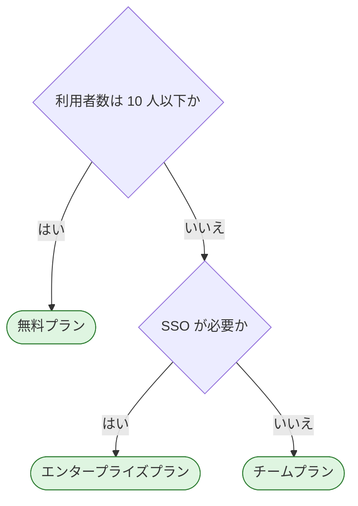

### sequence-diagram（シーケンス図）
- 描き方: Mermaid `sequenceDiagram`
- 忠実度: そのまま守れる
- 注意: `participant X as 名前` で別名を付ける。宣言順が左からの並びになるので、最初に送る主体を先に宣言する。同期は `->>`、非同期は `-)`、応答は `-->>`（破線）。`+` と `-` で処理中の帯を付ける。`loop 条件 ... end` の枠の条件は文字で書く。正常系と異常系は図を分ける。
- 例:
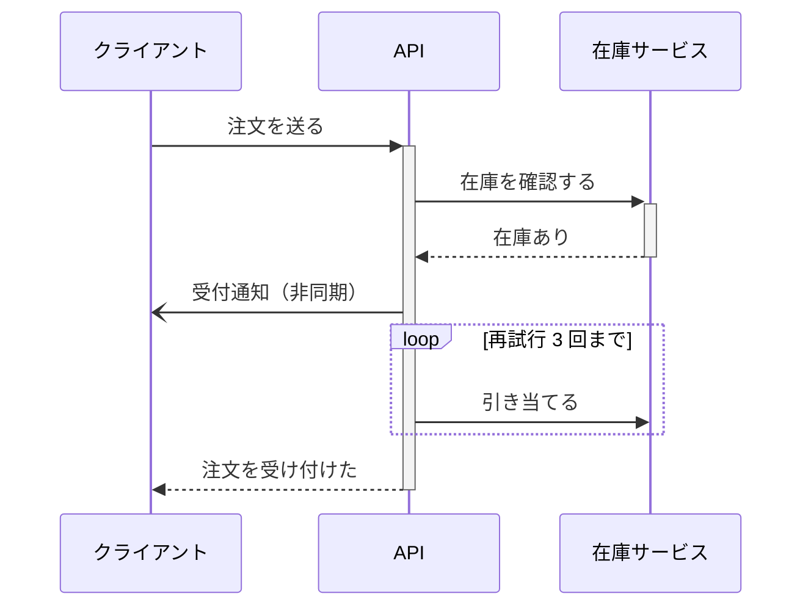

### flowchart（フローチャート）
- 描き方: Mermaid `flowchart`
- 忠実度: そのまま守れる
- 注意: 開始と終了は `([ ])`、処理は `[ ]`、判断は `{ }`。判断の出口は `-->|条件|` で必ず条件を書く。`TD` か `LR` の一方向にそろえる。合流は複数の節点から同じ節点へ辺を引けば一本にまとまる。
- 例:
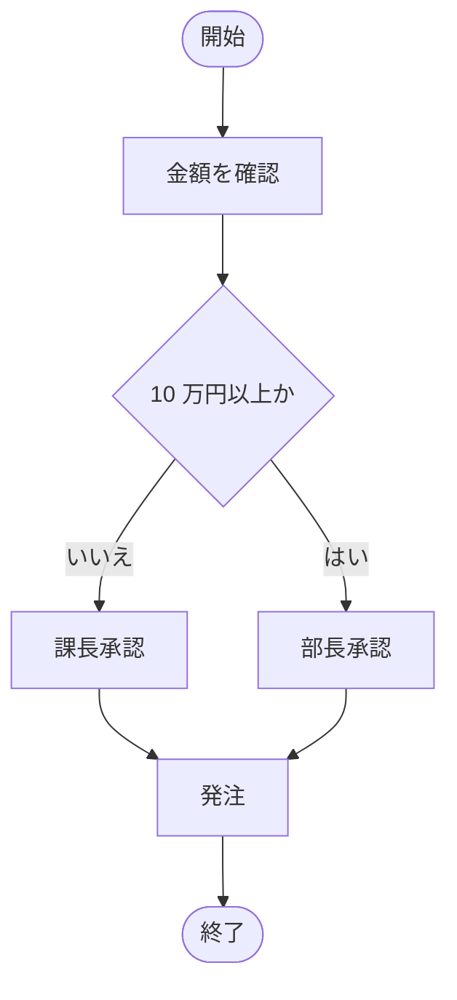

### tree-diagram（樹形図）
- 描き方: Mermaid `flowchart`
- 忠実度: そのまま守れる
- 注意: 親子は `---`（矢印なし）で結ぶ。`TD` が基本で、幅が広ければ `LR`。兄弟は宣言順に左から並び、同じ段に揃う。節の形は一種類にそろえる。段の色分けが要るときだけ `classDef` を使う。
- 例:
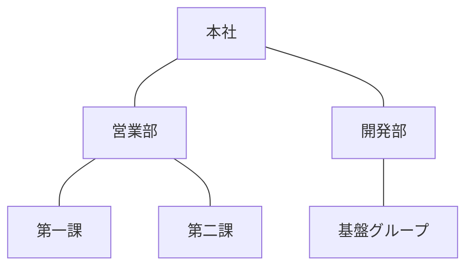

### mind-map（マインドマップ）
- 描き方: Mermaid `mindmap`
- 忠実度: 近似 — 失われる規則: 第一階層の枝を周囲に均等に配する、深さを中心からの距離で示す、文字を枝に沿って置く（自動レイアウトに任せるしかなく、保証されない）
- 注意: 字下げで階層を表し、中心は `root((主題))` に書く。放射状に置かれ、深さは中心からの距離で出る。第一階層ごとの色は theme `default` で自動的に付く（`neutral` にすると灰色になる）。枝は曲線で矢印はなく、深くなるほど細くなる。枝の配置に順序の意味がないことを添え書きで断る。確認済み。
- 例:
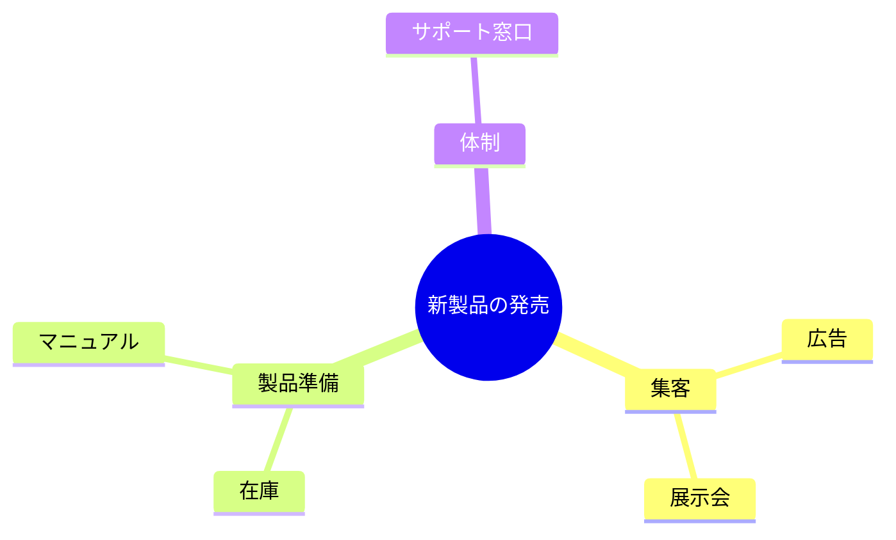

### venn-diagram（ベン図）
- 描き方: Vega-Lite（mark: point の塗り円を size 40000・opacity 0.45 で重ね、text でグループ名を外側に、項目名を領域の中に置く）
- 忠実度: そのまま守れる
- 注意: 円は 2〜3 個を同じ大きさで描き、重なりは opacity の混色で示す。項目は座標を手で決めて、属する領域の中に置く。重ならないグループは中心をずらして離す。軸は `axis: null` で消す。確認済み。
- 例:
```json
{
  "$schema": "https://vega.github.io/schema/vega-lite/v5.json",
  "width": 360,
  "height": 260,
  "layer": [
    {
      "data": {
        "values": [
          {
            "g": "無線",
            "x": -0.5,
            "y": 0
          },
          {
            "g": "防水",
            "x": 0.5,
            "y": 0
          }
        ]
      },
      "mark": {
        "type": "point",
        "filled": true,
        "size": 40000,
        "opacity": 0.45
      },
      "encoding": {
        "x": {
          "field": "x",
          "type": "quantitative",
          "scale": {
            "domain": [
              -2,
              2
            ]
          },
          "axis": null
        },
        "y": {
          "field": "y",
          "type": "quantitative",
          "scale": {
            "domain": [
              -1.5,
              1.5
            ]
          },
          "axis": null
        },
        "color": {
          "field": "g",
          "type": "nominal",
          "legend": null
        }
      }
    },
    {
      "data": {
        "values": [
          {
            "g": "無線",
            "x": -1.1,
            "y": 1.15
          },
          {
            "g": "防水",
            "x": 1.1,
            "y": 1.15
          }
        ]
      },
      "mark": {
        "type": "text",
        "fontSize": 14,
        "fontWeight": "bold"
      },
      "encoding": {
        "x": {
          "field": "x",
          "type": "quantitative"
        },
        "y": {
          "field": "y",
          "type": "quantitative"
        },
        "text": {
          "field": "g"
        }
      }
    },
    {
      "data": {
        "values": [
          {
            "n": "製品C",
            "x": -1,
            "y": 0
          },
          {
            "n": "製品A",
            "x": 0,
            "y": 0
          },
          {
            "n": "製品B",
            "x": 1,
            "y": 0
          }
        ]
      },
      "mark": {
        "type": "text",
        "fontSize": 12
      },
      "encoding": {
        "x": {
          "field": "x",
          "type": "quantitative"
        },
        "y": {
          "field": "y",
          "type": "quantitative"
        },
        "text": {
          "field": "n"
        }
      }
    }
  ]
}
```

### affinity-diagram（親和図）
- 描き方: Mermaid `flowchart`
- 忠実度: 近似 — 失われる規則: 札は同じ形・同じ大きさにする（ノードは文字量で大きさが変わる）。見出しは札より大きい文字にする（subgraph の見出しは札と同じ大きさ）。
- 注意: グループごとに `subgraph 見出し ... end` を作り、札はその中のノードにする。辺は引かない。枠が縦に積まれるので、順序と読まれやすい。枠の配置に順序の意味がないことをキャプションで断る。確認済み。
- 例:
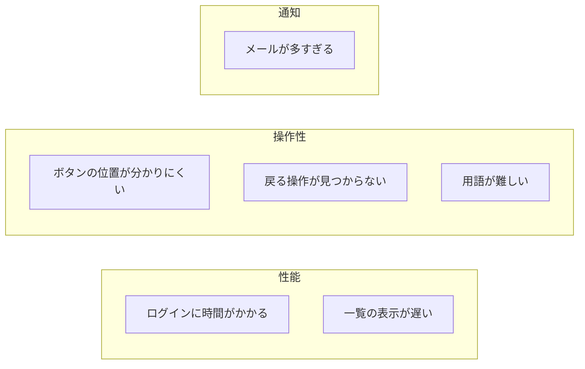

### cluster-diagram（クラスター図）
- 描き方: Mermaid `mindmap`
- 忠実度: 近似 — 失われる規則: グループを均等な角度で配する。中心からの距離は揃える（配置は自動レイアウトが決める）。グループを枠で囲むこともできない。
- 注意: 中心は `root((対象))`、グループは第一階層、項目は第二階層に字下げで書く。矢印は出ない。グループの色は theme `default` で自動的に付く（`neutral` は灰色）。配置に順序の意味がないことを添え書きで断る。
- 例:
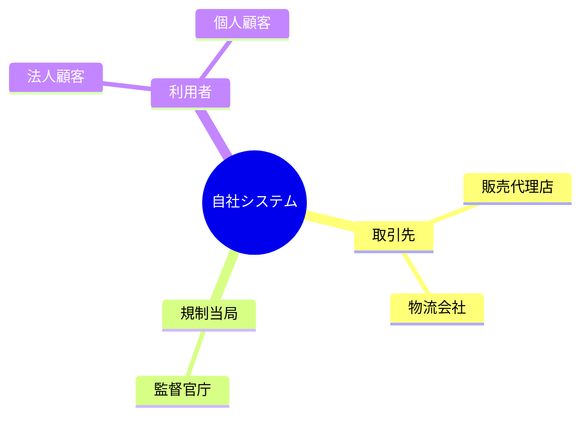

### concept-map（コンセプトマップ）
- 描き方: Mermaid `flowchart`
- 忠実度: そのまま守れる
- 注意: `TD` では辺の左側（起点）に書いた概念が上の段に来るので、一般的な概念を起点に書く。辺には必ずラベルを書く。向きのない関係は `---|"ラベル"|`、向きのある関係だけ `-->|"ラベル"|` にする。関連の強い概念の近接は自動配置に任せる（つながった節点は隣り合いやすい）。
- 例:
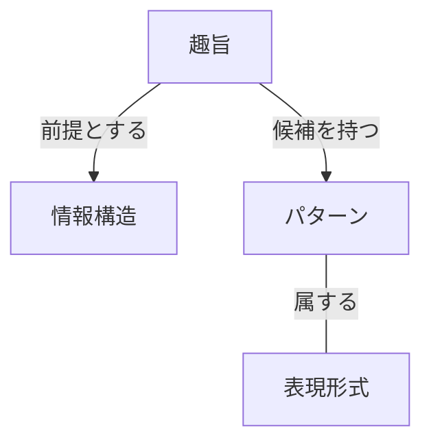

### er-diagram（ER図）
- 描き方: Mermaid `erDiagram`
- 忠実度: そのまま守れる
- 注意: 記法は IE（鳥の足）に統一される。`||--o{` のように多重度を両端に書き、`: 行う` で関係名を一方向の動詞で添える。属性は `{ }` の中に型・名前・`PK`/`FK` の順で書く。日本語の実体名と属性名は描ける（確認済み）。別名構文 `c["顧客"]` は mermaid 11.17.2 で Syntax error になるので、名前を直接書く。
- 例:
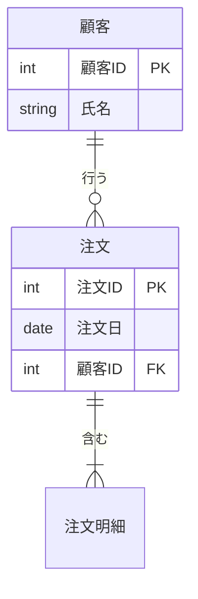

### network（ネットワーク図）
- 描き方: Mermaid `flowchart`
- 忠実度: 近似 — 失われる規則: 配置は自動レイアウトに任せ、密に結ばれたノードを近くに置く（dagre の階層レイアウトになり、上下左右に向きがあるように見える）。つながりの数をノードの大きさに対応づける（大きさの対応づけはできず、ノードごとの手作業の style だけ）。
- 注意: 辺は `---` で向きを付けない。グループの色は `classDef` で付ける。位置そのものに意味がないことをキャプションに書く。力学モデルの配置が要るなら Vega（Vega-Lite ではない）が必要になる。
- 例:
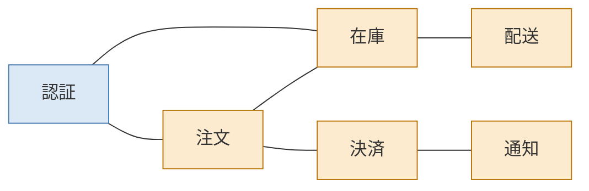

### cause-effect-chain（因果連鎖図）
- 描き方: Mermaid `flowchart`
- 忠実度: そのまま守れる
- 注意: `LR` か `TD` で一方向にそろえる。連鎖の段は自動的に揃い、始点の原因が一端に来る。伝えたい一本の連鎖は `linkStyle` で太線と色にし、枝は細いままにする。合流の AND と OR は図では区別できないので、本文で述べる（パターンの規則）。
- 例:
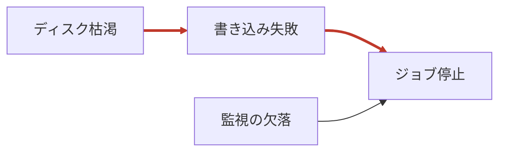

### ishikawa-diagram（特性要因図）
- 描き方: Mermaid `flowchart`
- 忠実度: 近似 — 失われる規則: 背骨を左から右へ引き、大骨を背骨の上下に交互に伸ばす幾何。右に根を持つ木として描かれる。
- 注意: `LR` で 原因 --> 分類 --> 結果 の向きに引くと、結果が右端に来る。結果・分類・確認済みの原因を `classDef` で色分けする。確認済み。
- 例:
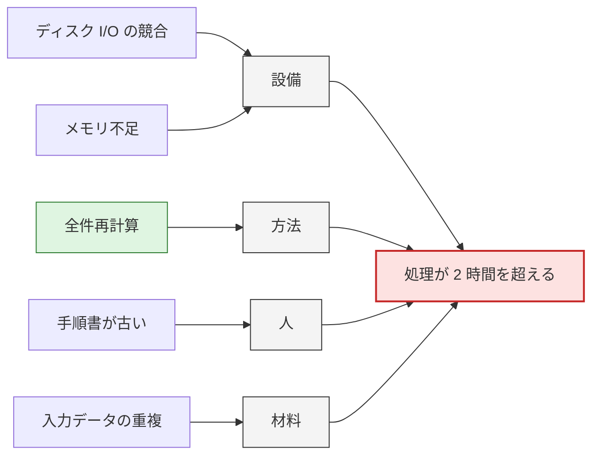

### fault-tree（故障の木）
- 描き方: Mermaid `flowchart`
- 忠実度: 近似 — 失われる規則: AND と OR を標準のゲート記号で区別する（mermaid 11.17.2 にゲートの形がない）。
- 注意: `TD` で頂上事象を最上部に置き、線は `---` にする。事象は `[ ]`、基本事象は `(( ))`、ゲートは `{{"AND"}}` と `{{"OR"}}` の六角形に `classDef` で色を付ける。ゲートの凡例は文字で書く。
- 例:
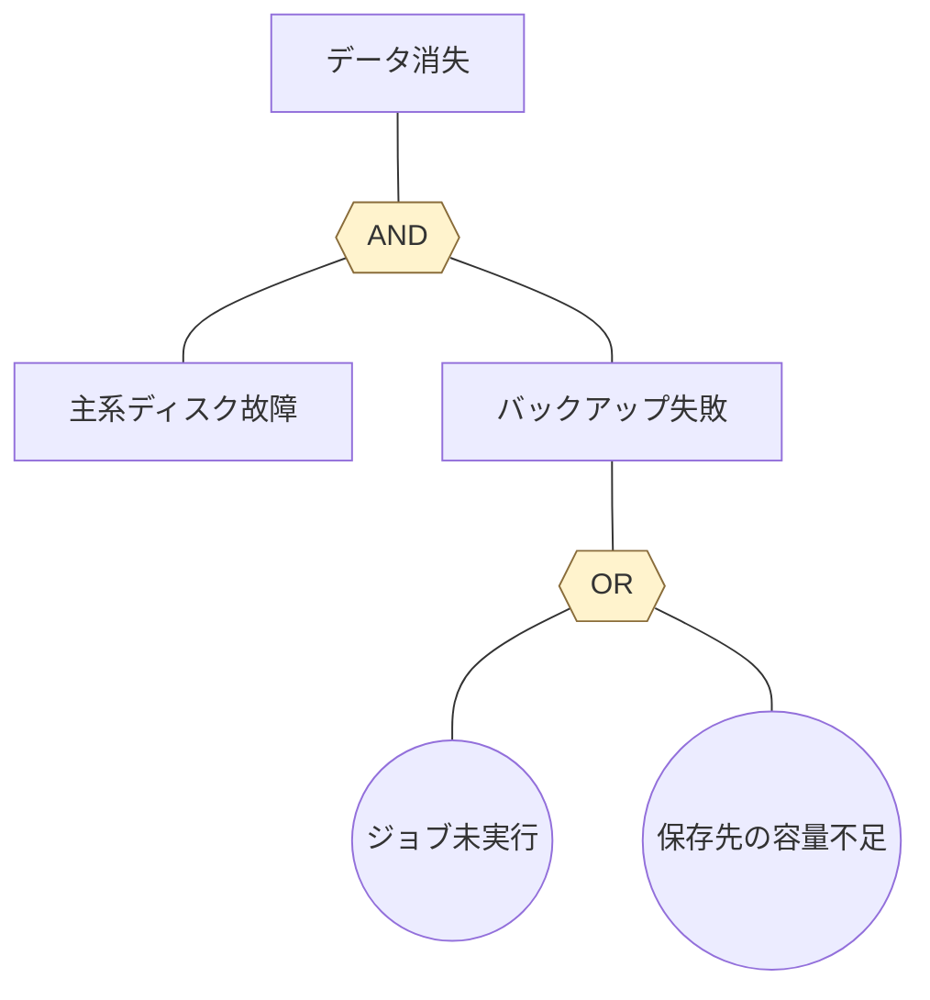

### feedback-diagram（因果ループ図）
- 描き方: Mermaid `flowchart`
- 忠実度: 近似 — 失われる規則: ループの中央に R か B の印を置く（印は独立したノードになり、ループの外に出る）。ループを作る変数を円環状に近く置く（配置は自動）。遅れがある因果は矢印に二重線を入れる（二重線の辺がない）。極性は矢じりの脇ではなく辺の中ほどに付く。
- 注意: 極性は `-->|+|` と `-->|−|` の辺ラベルで書く。ループは描ける（確認済み）。R/B の印は `(("R1")):::loop` のような独立ノードになる。極性と R・B の意味を凡例に書く。
- 例:
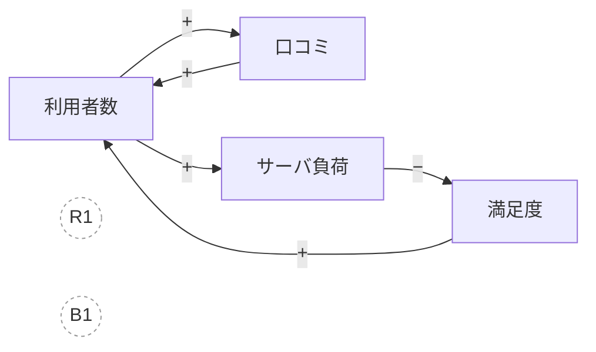

### stock-flow-diagram（ストック・フロー図）
- 描き方: Mermaid `flowchart`
- 忠実度: 近似 — 失われる規則: フローは弁の記号を持つ太い二重線の矢印で描く。図の外の始点・終点は雲の記号で示す（太線一本・六角形・破線の円で代用する）。
- 注意: ストックは `[ ]`、フローは `==>` の太線で `{{ }}` の弁ノードを経由させる。変数は `( )` にして `-.->` の細線でフローへ結ぶ。雲は `(("　"))` に `classDef` で破線を付ける。記号の意味を凡例に書く。確認済み。
- 例:
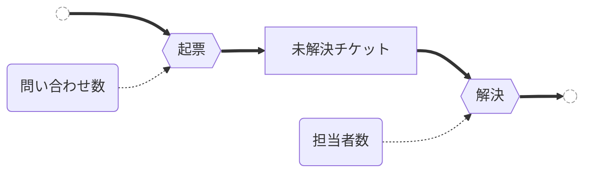

### cycle-diagram（サイクル図）
- 描き方: Vega-Lite（mark: arc で段階の間の弧、point の triangle-up を angle で回して矢じり、point の円を節点、text で名前）
- 忠実度: そのまま守れる
- 注意: 座標は transform の calculate で段階番号から計算する。12 時を起点に時計回り、等角になる。段階数を変えるときは `2 * PI / 4` の 4（二箇所）を段階数に置き換える。Mermaid の `flowchart LR A-->B-->C-->D-->A` や `stateDiagram-v2` でも描ける（確認済み）が、四角いループに戻り辺が一本付く形になり、円周上に等間隔という規則が失われる。
- 例:
```json
{
  "$schema": "https://vega.github.io/schema/vega-lite/v5.json",
  "width": 360,
  "height": 360,
  "data": {
    "values": [
      {
        "i": 0,
        "name": "1. 計画"
      },
      {
        "i": 1,
        "name": "2. 実行"
      },
      {
        "i": 2,
        "name": "3. 評価"
      },
      {
        "i": 3,
        "name": "4. 改善"
      }
    ]
  },
  "transform": [
    {
      "calculate": "datum.i * 2 * PI / 4",
      "as": "th"
    },
    {
      "calculate": "0.7 * sin(datum.th)",
      "as": "x"
    },
    {
      "calculate": "0.7 * cos(datum.th)",
      "as": "y"
    },
    {
      "calculate": "datum.th + 0.42",
      "as": "a0"
    },
    {
      "calculate": "datum.th + 2 * PI / 4 - 0.42",
      "as": "a1"
    },
    {
      "calculate": "0.7 * sin(datum.a1)",
      "as": "hx"
    },
    {
      "calculate": "0.7 * cos(datum.a1)",
      "as": "hy"
    },
    {
      "calculate": "datum.a1 * 180 / PI + 90",
      "as": "hang"
    }
  ],
  "layer": [
    {
      "mark": {
        "type": "arc",
        "color": "#555"
      },
      "encoding": {
        "theta": {
          "field": "a0",
          "type": "quantitative",
          "scale": {
            "domain": [
              0,
              6.283185307
            ]
          }
        },
        "theta2": {
          "field": "a1"
        },
        "radius": {
          "field": "r1",
          "type": "quantitative",
          "scale": {
            "type": "linear",
            "domain": [
              0,
              180
            ],
            "range": [
              0,
              180
            ]
          }
        },
        "radius2": {
          "field": "r0"
        }
      },
      "transform": [
        {
          "calculate": "127.5",
          "as": "r1"
        },
        {
          "calculate": "124.5",
          "as": "r0"
        }
      ]
    },
    {
      "mark": {
        "type": "point",
        "shape": "triangle-up",
        "filled": true,
        "size": 140,
        "color": "#555"
      },
      "encoding": {
        "x": {
          "field": "hx",
          "type": "quantitative",
          "scale": {
            "domain": [
              -1,
              1
            ]
          },
          "axis": null
        },
        "y": {
          "field": "hy",
          "type": "quantitative",
          "scale": {
            "domain": [
              -1,
              1
            ]
          },
          "axis": null
        },
        "angle": {
          "field": "hang",
          "type": "quantitative",
          "scale": {
            "domain": [
              0,
              360
            ],
            "range": [
              0,
              360
            ]
          }
        }
      }
    },
    {
      "mark": {
        "type": "point",
        "shape": "circle",
        "filled": true,
        "size": 4200,
        "color": "#e8f1fb",
        "stroke": "#5b8db8",
        "strokeWidth": 1.5
      },
      "encoding": {
        "x": {
          "field": "x",
          "type": "quantitative",
          "scale": {
            "domain": [
              -1,
              1
            ]
          }
        },
        "y": {
          "field": "y",
          "type": "quantitative",
          "scale": {
            "domain": [
              -1,
              1
            ]
          }
        }
      }
    },
    {
      "mark": {
        "type": "text",
        "fontSize": 12,
        "fontWeight": "bold"
      },
      "encoding": {
        "x": {
          "field": "x",
          "type": "quantitative",
          "scale": {
            "domain": [
              -1,
              1
            ]
          }
        },
        "y": {
          "field": "y",
          "type": "quantitative",
          "scale": {
            "domain": [
              -1,
              1
            ]
          }
        },
        "text": {
          "field": "name"
        }
      }
    }
  ]
}
```

### quadrant-matrix（2軸マトリクス）
- 描き方: Mermaid `quadrantChart`
- 忠実度: そのまま守れる
- 注意: `x-axis 名前 低 --> 高` と `y-axis 名前 低 --> 高` で軸名と高低の向きを端に書く。`quadrant-1` 〜 `quadrant-4` に象限名を書く。対象は `名前: [x, y]` で、評価の段階を 0〜1 の中に写す。目盛りは出ない（規則どおり）。確認済み。
- 例:
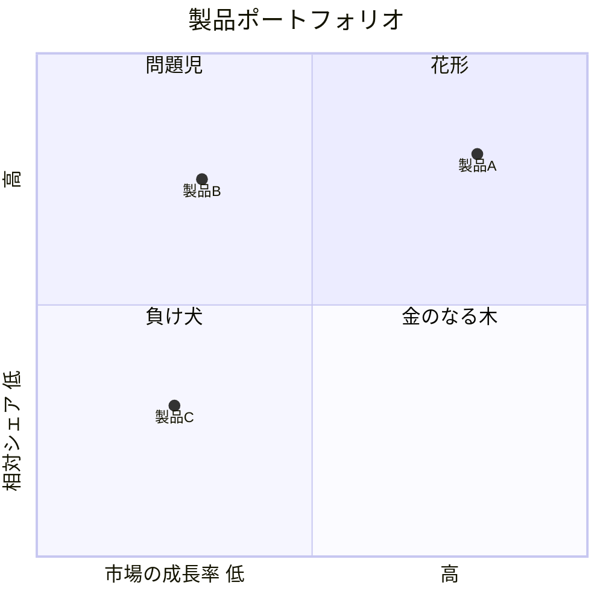

### continuum（両極スケール）
- 描き方: Vega-Lite（mark: rule で極から極への線、tick で中央の目印、point で対象、text で極名と対象名）
- 忠実度: そのまま守れる
- 注意: 軸は `axis: null` で消し、目盛りを付けない。極名は両端に `align` と `dx` で外側に置く。対象名は `dy` で点の上に出す。グループ分けは color encoding と凡例でできる。確認済み。
- 例:
```json
{
  "$schema": "https://vega.github.io/schema/vega-lite/v5.json",
  "width": 420,
  "height": 90,
  "layer": [
    {
      "data": {
        "values": [
          {
            "x0": 0,
            "x1": 1
          }
        ]
      },
      "mark": {
        "type": "rule",
        "strokeWidth": 2
      },
      "encoding": {
        "x": {
          "field": "x0",
          "type": "quantitative",
          "scale": {
            "domain": [
              -0.3,
              1.3
            ]
          },
          "axis": null
        },
        "x2": {
          "field": "x1"
        },
        "y": {
          "datum": 0,
          "scale": {
            "domain": [
              -1,
              1
            ]
          },
          "axis": null
        }
      }
    },
    {
      "data": {
        "values": [
          {
            "x": 0.5
          }
        ]
      },
      "mark": {
        "type": "tick",
        "thickness": 1,
        "color": "#aaa",
        "size": 16
      },
      "encoding": {
        "x": {
          "field": "x",
          "type": "quantitative"
        },
        "y": {
          "datum": 0
        }
      }
    },
    {
      "data": {
        "values": [
          {
            "x": 0,
            "label": "一貫性"
          }
        ]
      },
      "mark": {
        "type": "text",
        "fontSize": 13,
        "fontWeight": "bold",
        "align": "right",
        "dx": -8
      },
      "encoding": {
        "x": {
          "field": "x",
          "type": "quantitative"
        },
        "y": {
          "datum": 0
        },
        "text": {
          "field": "label"
        }
      }
    },
    {
      "data": {
        "values": [
          {
            "x": 1,
            "label": "可用性"
          }
        ]
      },
      "mark": {
        "type": "text",
        "fontSize": 13,
        "fontWeight": "bold",
        "align": "left",
        "dx": 8
      },
      "encoding": {
        "x": {
          "field": "x",
          "type": "quantitative"
        },
        "y": {
          "datum": 0
        },
        "text": {
          "field": "label"
        }
      }
    },
    {
      "data": {
        "values": [
          {
            "name": "システムA",
            "x": 0.3
          },
          {
            "name": "システムB",
            "x": 0.9
          }
        ]
      },
      "mark": {
        "type": "point",
        "filled": true,
        "size": 90,
        "color": "#333"
      },
      "encoding": {
        "x": {
          "field": "x",
          "type": "quantitative"
        },
        "y": {
          "datum": 0
        }
      }
    },
    {
      "data": {
        "values": [
          {
            "name": "システムA",
            "x": 0.3
          },
          {
            "name": "システムB",
            "x": 0.9
          }
        ]
      },
      "mark": {
        "type": "text",
        "dy": -14,
        "fontSize": 12
      },
      "encoding": {
        "x": {
          "field": "x",
          "type": "quantitative"
        },
        "y": {
          "datum": 0
        },
        "text": {
          "field": "name"
        }
      }
    }
  ]
}
```

### pert-chart（PERT 図）
- 描き方: Mermaid `flowchart`
- 忠実度: そのまま守れる
- 注意: `LR` で開始と終了を `(( ))` で一つずつ置く。節点の中身は HTML ラベルの `<br/>` で、作業名・所要・ES/EF・LS/LF・余裕の順に固定する。最長経路は `classDef` と `linkStyle` で一色（赤）にし、他は無彩色にする。定型の 3×3 の枠は文字の行に簡略化される。確認済み。
- 例:
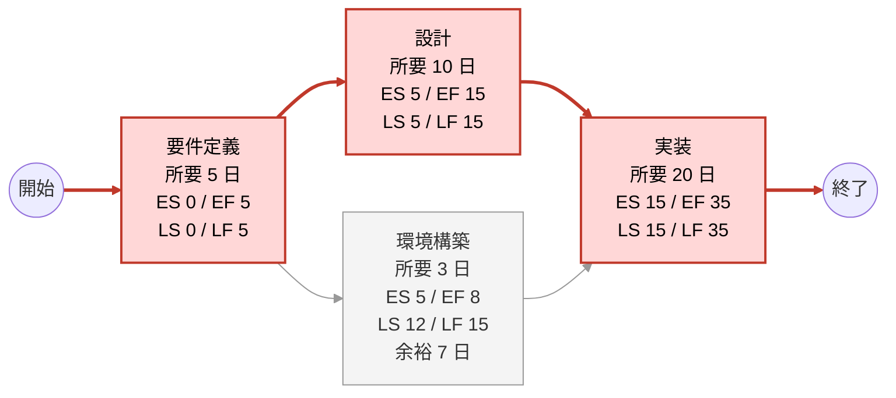

### technology-roadmap（ロードマップ）
- 描き方: Mermaid `gantt`
- 忠実度: 近似 — 失われる規則: 層をまたぐ対応を細い線で結ぶ（帯の間に線は引けない）。帯はレーンの中に並ぶのではなく、一行に一本ずつ並ぶ。
- 注意: `section` が層（レーン）、タスクが取り組みになる。`axisFormat %Y/%m` と `tickInterval 6month` で等間隔の粗い目盛りにし、`todayMarker off` にする。表示は粗くても、元の日付は `dateFormat YYYY-MM-DD` の日単位で書く必要がある。section の色は theme `default` で付く。確認済み。
- 例:
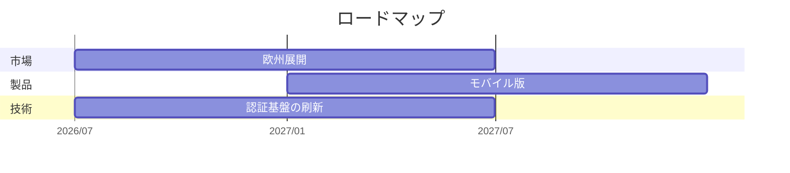

### minto-pyramid（ピラミッドストラクチャー）
- 描き方: Mermaid `flowchart`
- 忠実度: そのまま守れる
- 注意: `TD` で結論を最初に宣言し、`---` で結ぶ（矢印なし）。同じ段は自動的に横に揃い、左右の並びは宣言順になる。節の形は一種類にそろえる。確認済み。
- 例:
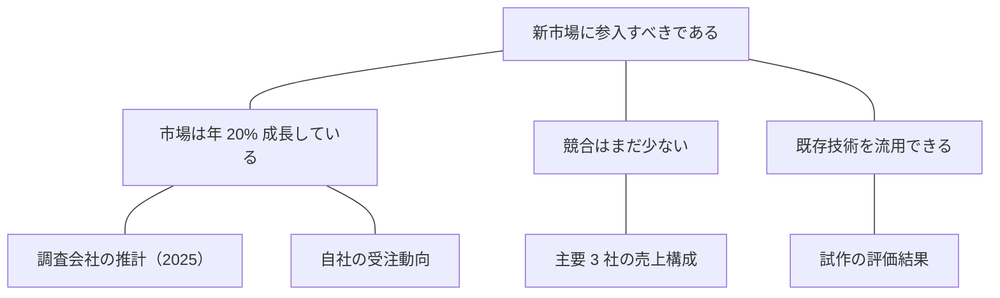

### toulmin-map（トゥールミン図）
- 描き方: Vega-Lite（mark: rect で役割ごとの箱を固定座標に置き、rule と point の triangle-right で矢印、text で本文と役割名、color で役割の凡例）
- 忠実度: そのまま守れる
- 注意: 配置は固定座標で決める。根拠 → 限定 → 主張 を左から右に、論拠は矢印の下、裏付けは論拠の下、反証は限定の下に置く。本文の改行は `lineBreak: "\n"` で入れる。Mermaid の flowchart でも描ける（確認済み）が、論拠が矢印の下ではなく左に置かれ、決まった配置が崩れるので近似になる。
- 例:
```json
{
  "$schema": "https://vega.github.io/schema/vega-lite/v5.json",
  "width": 600,
  "height": 330,
  "datasets": {
    "boxes": [
      {
        "role": "根拠",
        "x": 2,
        "x2": 26,
        "y": 40,
        "y2": 52,
        "text": "試験で欠陥率が\n0.1% 未満"
      },
      {
        "role": "限定",
        "x": 56,
        "x2": 70,
        "y": 40,
        "y2": 52,
        "text": "おそらく"
      },
      {
        "role": "主張",
        "x": 76,
        "x2": 98,
        "y": 40,
        "y2": 52,
        "text": "出荷できる"
      },
      {
        "role": "論拠",
        "x": 20,
        "x2": 48,
        "y": 20,
        "y2": 32,
        "text": "欠陥率 0.1% 未満は\n出荷基準を満たす"
      },
      {
        "role": "裏付け",
        "x": 20,
        "x2": 48,
        "y": 2,
        "y2": 14,
        "text": "出荷基準 QS-12"
      },
      {
        "role": "反証",
        "x": 56,
        "x2": 74,
        "y": 20,
        "y2": 32,
        "text": "ただし致命的欠陥が\n含まれる場合を除く"
      }
    ],
    "lines": [
      {
        "x": 26,
        "x2": 56,
        "y": 46,
        "y2": 46
      },
      {
        "x": 70,
        "x2": 76,
        "y": 46,
        "y2": 46
      },
      {
        "x": 41,
        "x2": 41,
        "y": 32,
        "y2": 46
      },
      {
        "x": 34,
        "x2": 34,
        "y": 14,
        "y2": 20
      },
      {
        "x": 63,
        "x2": 63,
        "y": 32,
        "y2": 40
      }
    ],
    "heads": [
      {
        "x": 56,
        "y": 46
      },
      {
        "x": 76,
        "y": 46
      }
    ]
  },
  "layer": [
    {
      "data": {
        "name": "lines"
      },
      "mark": {
        "type": "rule",
        "strokeWidth": 1.5,
        "color": "#444"
      },
      "encoding": {
        "x": {
          "field": "x",
          "type": "quantitative",
          "scale": {
            "domain": [
              0,
              100
            ]
          },
          "axis": null
        },
        "x2": {
          "field": "x2"
        },
        "y": {
          "field": "y",
          "type": "quantitative",
          "scale": {
            "domain": [
              0,
              60
            ]
          },
          "axis": null
        },
        "y2": {
          "field": "y2"
        }
      }
    },
    {
      "data": {
        "name": "heads"
      },
      "mark": {
        "type": "point",
        "shape": "triangle-right",
        "filled": true,
        "size": 120,
        "color": "#444"
      },
      "encoding": {
        "x": {
          "field": "x",
          "type": "quantitative",
          "scale": {
            "domain": [
              0,
              100
            ]
          }
        },
        "y": {
          "field": "y",
          "type": "quantitative",
          "scale": {
            "domain": [
              0,
              60
            ]
          }
        }
      }
    },
    {
      "data": {
        "name": "boxes"
      },
      "mark": {
        "type": "rect",
        "stroke": "#555",
        "cornerRadius": 3
      },
      "encoding": {
        "x": {
          "field": "x",
          "type": "quantitative",
          "scale": {
            "domain": [
              0,
              100
            ]
          }
        },
        "x2": {
          "field": "x2"
        },
        "y": {
          "field": "y",
          "type": "quantitative",
          "scale": {
            "domain": [
              0,
              60
            ]
          }
        },
        "y2": {
          "field": "y2"
        },
        "color": {
          "field": "role",
          "type": "nominal",
          "scale": {
            "domain": [
              "根拠",
              "限定",
              "主張",
              "論拠",
              "裏付け",
              "反証"
            ],
            "range": [
              "#e3f2fd",
              "#fff8e1",
              "#e8f5e9",
              "#f3e5f5",
              "#ede7f6",
              "#ffebee"
            ]
          },
          "legend": {
            "title": "役割",
            "orient": "bottom"
          }
        }
      }
    },
    {
      "data": {
        "name": "boxes"
      },
      "transform": [
        {
          "calculate": "(datum.x + datum.x2) / 2",
          "as": "cx"
        },
        {
          "calculate": "(datum.y + datum.y2) / 2",
          "as": "cy"
        }
      ],
      "mark": {
        "type": "text",
        "fontSize": 12,
        "lineBreak": "\n"
      },
      "encoding": {
        "x": {
          "field": "cx",
          "type": "quantitative",
          "scale": {
            "domain": [
              0,
              100
            ]
          }
        },
        "y": {
          "field": "cy",
          "type": "quantitative",
          "scale": {
            "domain": [
              0,
              60
            ]
          }
        },
        "text": {
          "field": "text"
        }
      }
    },
    {
      "data": {
        "name": "boxes"
      },
      "transform": [
        {
          "calculate": "datum.x + 1",
          "as": "lx"
        },
        {
          "calculate": "datum.y2 + 1.8",
          "as": "ly"
        }
      ],
      "mark": {
        "type": "text",
        "fontSize": 10,
        "align": "left",
        "color": "#666"
      },
      "encoding": {
        "x": {
          "field": "lx",
          "type": "quantitative",
          "scale": {
            "domain": [
              0,
              100
            ]
          }
        },
        "y": {
          "field": "ly",
          "type": "quantitative",
          "scale": {
            "domain": [
              0,
              60
            ]
          }
        },
        "text": {
          "field": "role"
        }
      }
    }
  ]
}
```

### ibis-map（IBIS 図）
- 描き方: Mermaid `flowchart`
- 忠実度: そのまま守れる
- 注意: `LR` で論点を最初に宣言すると左に来る。論点は `{{ }}` に `?` を付け、立場と論拠は `[ ]` に `+` と `−` の記号を付ける。賛否は `classDef` の色で分け、凡例は `subgraph 凡例` に置く。線は `---` で、応答する節から応答先へ引く。確認済み。
- 例:
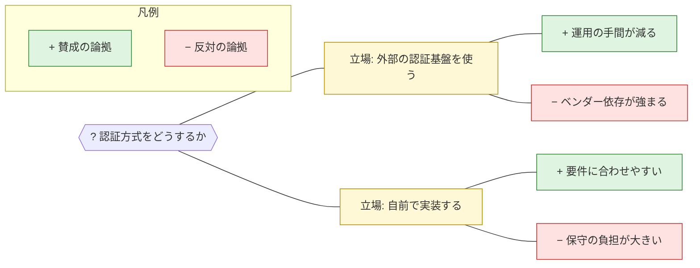

### layer-diagram（レイヤー図）
- 描き方: Mermaid `block-beta`
- 忠実度: そのまま守れる
- 注意: `columns 1` の下に層ごとの `block:ID ... end` を入れ子にし、中で `columns N` を指定する。先頭のセルを層の名前にすると左端に来る。`style` で層ごとに色を付ける。矢印は引かない。幅と高さは揃う。宣言順が上から下になるので、土台は最後に宣言する。確認済み。
- 例:
```mermaid
block-beta
  columns 1
  block:L3
    columns 3
    n3["UI 層"] a["Web"] b["モバイル"]
  end
  block:L2
    columns 3
    n2["業務ロジック層"] c["注文"] d["在庫"]
  end
  block:L1
    columns 3
    n1["データ層"] e["DB"] f["キャッシュ"]
  end
  style L3 fill:#e8f1fb,stroke:#5b8db8
  style L2 fill:#eef7ea,stroke:#6a9a5b
  style L1 fill:#f7efe6,stroke:#b08a5a
```

### concentric-circles（同心円図）
- 描き方: Vega-Lite（mark: arc で theta 0〜1 の全周の環を radius/radius2 で層ごとに描き、text を theta 0・環の中央の半径に置く）
- 忠実度: そのまま守れる
- 注意: 環の幅は transform で `order * 50` のように等幅にする。`resolve.scale.color: independent` が必須で、ないと文字が環と同じ色になって消える。層の名前は 12 時の位置に出る。要素を置くときは text の行を足し、theta と radius を手で決める。確認済み。
- 例:
```json
{
  "$schema": "https://vega.github.io/schema/vega-lite/v5.json",
  "width": 320,
  "height": 320,
  "data": {
    "values": [
      {
        "layer": "中核",
        "order": 1
      },
      {
        "layer": "直接の利用者",
        "order": 2
      },
      {
        "layer": "間接の利用者",
        "order": 3
      }
    ]
  },
  "transform": [
    {
      "calculate": "(datum.order - 1) * 50",
      "as": "r0"
    },
    {
      "calculate": "datum.order * 50",
      "as": "r1"
    },
    {
      "calculate": "datum.order * 50 - 25",
      "as": "rt"
    },
    {
      "calculate": "0",
      "as": "t0"
    },
    {
      "calculate": "1",
      "as": "t1"
    }
  ],
  "layer": [
    {
      "mark": {
        "type": "arc",
        "stroke": "white",
        "strokeWidth": 2
      },
      "encoding": {
        "theta": {
          "field": "t0",
          "type": "quantitative",
          "scale": {
            "domain": [
              0,
              1
            ]
          }
        },
        "theta2": {
          "field": "t1"
        },
        "radius": {
          "field": "r1",
          "type": "quantitative",
          "scale": {
            "type": "linear",
            "domain": [
              0,
              150
            ],
            "range": [
              0,
              150
            ]
          }
        },
        "radius2": {
          "field": "r0"
        },
        "order": {
          "field": "order",
          "sort": "descending"
        },
        "color": {
          "field": "layer",
          "type": "nominal",
          "sort": {
            "field": "order"
          },
          "scale": {
            "range": [
              "#1d4e89",
              "#6aa5d8",
              "#cfe3f5"
            ]
          },
          "legend": null
        }
      }
    },
    {
      "mark": {
        "type": "text",
        "fontSize": 12,
        "fontWeight": "bold"
      },
      "encoding": {
        "theta": {
          "field": "t0",
          "type": "quantitative"
        },
        "radius": {
          "field": "rt",
          "type": "quantitative"
        },
        "text": {
          "field": "layer"
        },
        "color": {
          "field": "layer",
          "type": "nominal",
          "scale": {
            "range": [
              "#fff",
              "#fff",
              "#123"
            ]
          },
          "legend": null
        }
      }
    }
  ],
  "resolve": {
    "scale": {
      "color": "independent"
    }
  }
}
```

### communication-diagram（コミュニケーション図）
- 描き方: Mermaid `flowchart`
- 忠実度: 近似 — 失われる規則: 主体の配置に時間の意味を持たせない（dagre は辺の向きに沿って段を作るので、順番に見える）。同じ線に複数のメッセージを番号順に上から並べる（辺ラベルは一本に一つ）。
- 注意: 主体は `[ ]` にし、やり取りのある主体同士だけを結ぶ。ラベルは `"番号: 内容"` で矢じり付きにする。複数のメッセージは平行な辺を引くか `<br/>` で重ねる。
- 例:
```mermaid
flowchart LR
  U["画面"] -->|"1: 注文を登録する"| O["注文コントローラ"]
  O -->|"2: 在庫を引き当てる"| S["在庫"]
  O -->|"3: 決済を依頼する"| P["決済"]
```

### swim-lane-diagram（スイムレーン図）
- 描き方: Mermaid `flowchart`
- 忠実度: 近似 — 失われる規則: 帯状のレーン（subgraph は自動配置の箱で、全長にわたる平行な帯にならない）。同じレーンの節点が離れて置かれることがある（確認時、修正の節点が申請者レーンの右端に離れた）。
- 注意: 担当ごとに `subgraph 担当` を作り、中に `direction TB` を書く。図形と出口の条件は flowchart と同じにする。subgraph をまたぐ辺が引き継ぎになる。
- 例:
```mermaid
flowchart LR
  subgraph 申請者
    direction TB
    a1([開始]) --> a2[申請を起票]
    a4[修正]
  end
  subgraph 上長
    direction TB
    b1{内容を確認}
  end
  subgraph 経理
    direction TB
    c1[支払] --> c2([終了])
  end
  a2 --> b1
  b1 -->|承認| c1
  b1 -->|差戻| a4
  a4 --> b1
```

### metro-map（メトロマップ）
- 描き方: Mermaid `flowchart`
- 忠実度: 近似 — 失われる規則: 線は水平・垂直・45 度に限って折れ線にする（曲線で描かれる）。おおまかな時期の目盛りを添える（目盛りは付けられない）。
- 注意: 系列ごとに `linkStyle` で色と太さ（4px）を付ける。駅は `(( ))`、複数の系列が交わる節目は `((( )))` の二重丸にする。路線に沿った順は宣言順になる。駅の間隔に意味がないことをキャプションに書く。路線名の凡例は文章で添える。確認済み。
- 例:
```mermaid
flowchart LR
  k1((基盤: 設計)) --> k2(((認証基盤の切替))) --> k3((基盤: 監視整備))
  m1((モバイル: 試作)) --> k2 --> m3((モバイル版公開))
  linkStyle 0,1 stroke:#1f77b4,stroke-width:4px
  linkStyle 2,3 stroke:#d62728,stroke-width:4px
```

### temple（神殿の比喩）
- 描き方: Mermaid `block-beta`
- 忠実度: 近似 — 失われる規則: 土台・柱・屋根の形で役割を区別する（柱と土台はどちらも長方形で、幅と色だけが違う。屋根は台形で、切妻ではない）。
- 注意: `columns N` で柱の数を決める。屋根は `[/"..."\]:N` の台形で全列にまたがらせ、土台は `:N` で全列に広げる。`style` で部位ごとに色を付ける。柱は等幅・等高で並ぶ。確認済み。
- 例:
```mermaid
block-beta
  columns 3
  roof[/"目標: 顧客満足"\]:3
  p1["品質"] p2["速度"] p3["安全"]
  base["前提: 共通の価値観"]:3
  style roof fill:#f3e3c3,stroke:#8a6d3b
  style base fill:#ddd,stroke:#555
```

### iceberg（氷山の比喩）
- 描き方: Vega-Lite（mark: rect で層ごとに等面積の帯、rule の破線で水面、text で層の名前と「水面」）
- 忠実度: 近似 — 失われる規則: 氷山になぞらえる輪郭（積み上げた長方形になり、比喩は水面の線と色の対比だけで担う）。
- 注意: 見える・隠れたの色は color の domain と range で固定する。`resolve.scale.color: independent` が必須で、ないと文字が見えない（確認済み）。水面は `rule` に `strokeDash` を付ける。層の面積は等しく保つ。
- 例:
```json
{
  "$schema": "https://vega.github.io/schema/vega-lite/v5.json",
  "width": 320,
  "height": 300,
  "data": {
    "values": [
      {
        "layer": "不具合の症状",
        "y0": 3,
        "y1": 4,
        "vis": "見える"
      },
      {
        "layer": "実装の癖",
        "y0": 2,
        "y1": 3,
        "vis": "隠れた"
      },
      {
        "layer": "設計の判断",
        "y0": 1,
        "y1": 2,
        "vis": "隠れた"
      },
      {
        "layer": "前提の認識",
        "y0": 0,
        "y1": 1,
        "vis": "隠れた"
      }
    ]
  },
  "transform": [
    {
      "calculate": "(datum.y0 + datum.y1) / 2",
      "as": "ym"
    }
  ],
  "layer": [
    {
      "mark": {
        "type": "rect",
        "stroke": "white",
        "strokeWidth": 2
      },
      "encoding": {
        "x": {
          "datum": 0,
          "scale": {
            "domain": [
              0,
              1
            ]
          },
          "axis": null
        },
        "x2": {
          "datum": 1
        },
        "y": {
          "field": "y0",
          "type": "quantitative",
          "scale": {
            "domain": [
              0,
              4
            ]
          },
          "axis": null
        },
        "y2": {
          "field": "y1"
        },
        "color": {
          "field": "vis",
          "type": "nominal",
          "scale": {
            "domain": [
              "見える",
              "隠れた"
            ],
            "range": [
              "#bfe3ff",
              "#2a5d8f"
            ]
          },
          "legend": {
            "title": null
          }
        }
      }
    },
    {
      "mark": {
        "type": "text",
        "fontSize": 13,
        "fontWeight": "bold"
      },
      "encoding": {
        "x": {
          "datum": 0.5
        },
        "y": {
          "field": "ym",
          "type": "quantitative"
        },
        "text": {
          "field": "layer"
        },
        "color": {
          "field": "vis",
          "type": "nominal",
          "scale": {
            "domain": [
              "見える",
              "隠れた"
            ],
            "range": [
              "#0b2b45",
              "#ffffff"
            ]
          },
          "legend": null
        }
      }
    },
    {
      "mark": {
        "type": "rule",
        "strokeWidth": 3,
        "color": "#0a4f9c",
        "strokeDash": [
          6,
          3
        ]
      },
      "encoding": {
        "y": {
          "datum": 3
        }
      }
    },
    {
      "mark": {
        "type": "text",
        "align": "left",
        "dx": 4,
        "dy": -8,
        "fontSize": 11,
        "color": "#0a4f9c"
      },
      "encoding": {
        "x": {
          "datum": 0
        },
        "y": {
          "datum": 3
        },
        "text": {
          "value": "水面"
        }
      }
    }
  ],
  "resolve": {
    "scale": {
      "color": "independent"
    }
  }
}
```

### funnel（漏斗の比喩）
- 描き方: Vega-Lite（mark: bar を x=-count/2 〜 x2=count/2 で中央寄せにし、y は段階順の ordinal、text で値を x=0 に置く）
- 忠実度: そのまま守れる
- 注意: 帯の幅は残る量に比例し、段差状になる（滑らかにしない。パターンの警告どおり）。順序は `sort: {"field": "order"}` で決める。色は段階の区別だけに使い、`legend: null` にする。段階の間の減少率は本文に書く。確認済み。
- 例:
```json
{
  "$schema": "https://vega.github.io/schema/vega-lite/v5.json",
  "width": 400,
  "height": 180,
  "data": {
    "values": [
      {
        "stage": "訪問",
        "order": 1,
        "count": 10000
      },
      {
        "stage": "登録",
        "order": 2,
        "count": 2500
      },
      {
        "stage": "購入",
        "order": 3,
        "count": 400
      }
    ]
  },
  "transform": [
    {
      "calculate": "-datum.count/2",
      "as": "x1"
    },
    {
      "calculate": "datum.count/2",
      "as": "x2"
    }
  ],
  "encoding": {
    "y": {
      "field": "stage",
      "type": "ordinal",
      "sort": {
        "field": "order"
      },
      "axis": {
        "title": null,
        "labelFontSize": 13
      }
    }
  },
  "layer": [
    {
      "mark": {
        "type": "bar",
        "height": 40
      },
      "encoding": {
        "x": {
          "field": "x1",
          "type": "quantitative",
          "axis": null
        },
        "x2": {
          "field": "x2"
        },
        "color": {
          "field": "stage",
          "type": "nominal",
          "legend": null
        }
      }
    },
    {
      "mark": {
        "type": "text",
        "fontSize": 12
      },
      "encoding": {
        "x": {
          "datum": 0
        },
        "text": {
          "field": "count",
          "type": "quantitative",
          "format": ","
        }
      }
    }
  ]
}
```

### tree-metaphor（樹木の比喩）
- 描き方: なし
- 忠実度: 描けない — 根・幹・枝・葉の形で役割を区別し、親子を枝の接続で示す（線を別に引かない）規則を守れる描き方がない。flowchart の BT は箱と線の樹形図を逆さにしただけで、block-beta は幹や枝の形を描けず、Vega-Lite に有機的な形の mark はない。手描きの SVG や挿絵（画像）だけが実現できるが、決定論的ではない。代わりに tree-diagram か mind-map に切り替えるか、根・幹・枝の対応を文章で述べる。
- 注意: 画像を用意できる場合だけ、画像として埋め込む。

### data-flow-diagram（データフロー図）
- 描き方: Mermaid `flowchart`
- 忠実度: 近似 — 失われる規則: データストアは開いた長方形で描く（mermaid 11.17.2 に開いた長方形の形がないので、`lin-rect` か `cyl` で代用し、凡例と記法の注記で補う）。
- 注意: 処理は `(( ))`、外部実体は `[ ]`、データストアは `@{ shape: lin-rect, label: "..." }` で書く。辺は向きありで、`|"データ名"|` を必ず書く。システムの境界は `subgraph` で囲む。
- 例:
```mermaid
flowchart LR
  EXT["営業担当"]
  EXT2["経理"]
  subgraph システム境界
    P1(("1. 受注を登録"))
    P2(("2. 集計バッチ"))
    DS1@{ shape: lin-rect, label: "D1 注文" }
    DS2@{ shape: lin-rect, label: "D2 売上" }
  end
  EXT -->|"受注情報"| P1
  P1 -->|"注文"| DS1
  DS2 -->|"日次売上"| P2
  P2 -->|"集計結果"| EXT2
```

### force-field-diagram（フォースフィールド図）
- 描き方: Vega-Lite（mark: bar で 0 からの符号付きの長さ、point を x=0 に置き shape を triangle-right/left にして矢じり（scale: null）、rule で中央線）
- 忠実度: そのまま守れる
- 注意: 推進は負、抑制は正になるよう calculate で符号を付け、左右に分ける。長さは 3〜5 段階の固定 domain（例: [-5, 5]）にする。色は側ごとに domain と range で固定し、凡例を付ける。変化の対象は `title` に書く。確認済み。
- 例:
```json
{
  "$schema": "https://vega.github.io/schema/vega-lite/v5.json",
  "width": 420,
  "height": 160,
  "title": "テスト自動化の導入",
  "data": {
    "values": [
      {
        "name": "手動テストの工数増",
        "side": "推進",
        "strength": 3
      },
      {
        "name": "品質事故の再発",
        "side": "推進",
        "strength": 2
      },
      {
        "name": "既存コードの結合度",
        "side": "抑制",
        "strength": 2
      },
      {
        "name": "学習コスト",
        "side": "抑制",
        "strength": 1
      }
    ]
  },
  "transform": [
    {
      "calculate": "datum.side == '推進' ? -datum.strength : datum.strength",
      "as": "start"
    },
    {
      "calculate": "datum.side == '推進' ? 'triangle-right' : 'triangle-left'",
      "as": "head"
    }
  ],
  "encoding": {
    "y": {
      "field": "name",
      "type": "nominal",
      "axis": {
        "title": null,
        "labelFontSize": 12
      }
    }
  },
  "layer": [
    {
      "mark": {
        "type": "bar",
        "height": 6
      },
      "encoding": {
        "x": {
          "field": "start",
          "type": "quantitative",
          "scale": {
            "domain": [
              -5,
              5
            ]
          },
          "axis": null
        },
        "x2": {
          "datum": 0
        },
        "color": {
          "field": "side",
          "type": "nominal",
          "scale": {
            "domain": [
              "推進",
              "抑制"
            ],
            "range": [
              "#2a9d8f",
              "#e76f51"
            ]
          },
          "legend": {
            "title": "要因"
          }
        }
      }
    },
    {
      "mark": {
        "type": "point",
        "filled": true,
        "size": 160
      },
      "encoding": {
        "x": {
          "datum": 0
        },
        "shape": {
          "field": "head",
          "type": "nominal",
          "scale": null,
          "legend": null
        },
        "color": {
          "field": "side",
          "type": "nominal",
          "legend": null
        }
      }
    },
    {
      "mark": {
        "type": "rule",
        "strokeWidth": 2,
        "color": "#333"
      },
      "encoding": {
        "x": {
          "datum": 0
        }
      }
    }
  ]
}
```

## chart 系

### timeline（タイムライン）
- 描き方: Vega-Lite（mark: temporal x・y=0 の point に、短い縦線の rule と名前の text を上下交互に重ね、分類を color で分ける）
- 忠実度: そのまま守れる
- 注意: 上下交互の位置は window の row_number を 2 で割った余りで決める。節目は size や fontWeight の condition で目立たせる。軸は時間に比例する（確認済み）。Mermaid の timeline も描けるが、期間を等間隔に並べて出来事を箱で囲むため、「目盛りを等間隔に打って時間に比例させる」が崩れて近似になる。
- 例:
```json
{
  "data": {
    "values": [
      {
        "d": "2019-04-01",
        "h": "創業",
        "c": "経営"
      },
      {
        "d": "2021-06-15",
        "h": "資金調達",
        "c": "財務"
      },
      {
        "d": "2024-10-01",
        "h": "上場",
        "c": "財務"
      }
    ]
  },
  "transform": [
    {
      "window": [
        {
          "op": "row_number",
          "as": "i"
        }
      ],
      "sort": [
        {
          "field": "d"
        }
      ]
    },
    {
      "calculate": "0",
      "as": "z"
    },
    {
      "calculate": "datum.i % 2 == 0 ? 20 : -20",
      "as": "yy"
    },
    {
      "calculate": "datum.i % 2 == 0 ? 26 : -26",
      "as": "ty"
    }
  ],
  "layer": [
    {
      "mark": {
        "type": "point",
        "filled": true,
        "size": 120
      },
      "encoding": {
        "x": {
          "field": "d",
          "type": "temporal",
          "axis": {
            "title": null,
            "format": "%Y"
          }
        },
        "y": {
          "field": "z",
          "type": "quantitative",
          "axis": null,
          "scale": {
            "domain": [
              -40,
              40
            ]
          }
        },
        "color": {
          "field": "c",
          "type": "nominal"
        }
      }
    },
    {
      "mark": {
        "type": "rule",
        "color": "#333"
      },
      "encoding": {
        "y": {
          "field": "z",
          "type": "quantitative"
        }
      }
    },
    {
      "mark": {
        "type": "rule",
        "color": "#999"
      },
      "encoding": {
        "x": {
          "field": "d",
          "type": "temporal"
        },
        "y": {
          "field": "z",
          "type": "quantitative"
        },
        "y2": {
          "field": "yy"
        }
      }
    },
    {
      "mark": {
        "type": "text"
      },
      "encoding": {
        "x": {
          "field": "d",
          "type": "temporal"
        },
        "y": {
          "field": "ty",
          "type": "quantitative"
        },
        "text": {
          "field": "h",
          "type": "nominal"
        }
      }
    }
  ],
  "width": 500,
  "height": 120,
  "$schema": "https://vega.github.io/schema/vega-lite/v5.json"
}
```

### gantt-chart（ガントチャート）
- 描き方: Mermaid `gantt`
- 忠実度: 近似 — 失われる規則: 「依存は先行作業の右端から後続作業の左端へ矢印を引く」。棒の間の矢印は描かれない
- 注意: section が段階ごとの見出し行、`:milestone` が幅のない節目、`todayMarker on` が今日の縦線になる。dateFormat と axisFormat で日付の書式と目盛を決める。`after a1` で先行作業の直後に置けるが矢印にはならないので、主要な依存は本文で補う。Vega-Lite の bar（temporal の x/x2）と今日の rule でも描ける（確認済み）。そこに矢印の rule と point の層を足す方法は未確認。
- 例:
```mermaid
gantt
    title 計画
    dateFormat YYYY-MM-DD
    axisFormat %m/%d
    todayMarker on
    section 設計
    要件定義 :a1, 2026-10-01, 10d
    基本設計 :a2, after a1, 7d
    設計完了 :milestone, m1, after a2, 0d
    section 実装
    実装 :b1, after a2, 14d
    試験 :b2, after b1, 7d
```

### diverging-bar-chart（分岐横棒グラフ）
- 描き方: Vega-Lite（mark: nominal y・quantitative x の bar を正負で color の condition により塗り分け、x=0 に太い rule を重ねる）
- 忠実度: そのまま守れる
- 注意: 左右の目盛範囲を同じにするには x の scale.domain を対称な値で明示する。基準の値は x の axis.title に書く。項目は sort で値の順に並べる。
- 例:
```json
{
  "data": {
    "values": [
      {
        "k": "A",
        "v": -12
      },
      {
        "k": "B",
        "v": 8
      },
      {
        "k": "C",
        "v": -3
      },
      {
        "k": "D",
        "v": 15
      }
    ]
  },
  "layer": [
    {
      "mark": "bar",
      "encoding": {
        "y": {
          "field": "k",
          "type": "nominal",
          "sort": "-x"
        },
        "x": {
          "field": "v",
          "type": "quantitative",
          "axis": {
            "title": "基準からの差"
          }
        },
        "color": {
          "condition": {
            "test": "datum.v < 0",
            "value": "#c0504d"
          },
          "value": "#4f81bd"
        }
      }
    },
    {
      "mark": {
        "type": "rule",
        "strokeWidth": 2
      },
      "encoding": {
        "x": {
          "datum": 0
        }
      }
    }
  ],
  "$schema": "https://vega.github.io/schema/vega-lite/v5.json"
}
```

### diverging-stacked-bar-chart（分岐対称積み上げ横棒グラフ）
- 描き方: Vega-Lite（mark: calculate で中立を半分に割り、fold と stack で区分順に積み、bar の x/x2 を発散配色の color で塗り、x=0 に rule）
- 忠実度: そのまま守れる
- 注意: 中立は neg と pos に半分ずつ振り分けて中央線をまたがせる。否定側は順序を反転して鏡写しに積む。color の scale.range に否定の濃淡・無彩色の中立・肯定の濃淡の順で色を並べ、sort で区分の順序を固定する。設問を肯定側の割合順に並べるなら、joinaggregate で肯定の合計を出して y の sort に使う。
- 例:
```json
{
  "data": {
    "values": [
      {
        "q": "Q1",
        "r": "強く反対",
        "v": 10
      },
      {
        "q": "Q1",
        "r": "反対",
        "v": 20
      },
      {
        "q": "Q1",
        "r": "中立",
        "v": 20
      },
      {
        "q": "Q1",
        "r": "賛成",
        "v": 30
      },
      {
        "q": "Q1",
        "r": "強く賛成",
        "v": 20
      },
      {
        "q": "Q2",
        "r": "強く反対",
        "v": 5
      },
      {
        "q": "Q2",
        "r": "反対",
        "v": 10
      },
      {
        "q": "Q2",
        "r": "中立",
        "v": 30
      },
      {
        "q": "Q2",
        "r": "賛成",
        "v": 35
      },
      {
        "q": "Q2",
        "r": "強く賛成",
        "v": 20
      }
    ]
  },
  "transform": [
    {
      "calculate": "indexof(['強く反対','反対','中立','賛成','強く賛成'], datum.r)",
      "as": "i"
    },
    {
      "calculate": "datum.i < 2 ? -datum.v : (datum.i == 2 ? -datum.v/2 : 0)",
      "as": "neg"
    },
    {
      "calculate": "datum.i > 2 ? datum.v : (datum.i == 2 ? datum.v/2 : 0)",
      "as": "pos"
    },
    {
      "fold": [
        "neg",
        "pos"
      ],
      "as": [
        "side",
        "val"
      ]
    },
    {
      "filter": "datum.val != 0"
    },
    {
      "calculate": "datum.side == 'neg' ? 10 - datum.i : datum.i",
      "as": "ord"
    },
    {
      "stack": "val",
      "groupby": [
        "q",
        "side"
      ],
      "sort": [
        {
          "field": "ord"
        }
      ],
      "as": [
        "x0",
        "x1"
      ]
    }
  ],
  "layer": [
    {
      "mark": "bar",
      "encoding": {
        "y": {
          "field": "q",
          "type": "nominal"
        },
        "x": {
          "field": "x0",
          "type": "quantitative",
          "axis": {
            "title": "%"
          }
        },
        "x2": {
          "field": "x1"
        },
        "color": {
          "field": "r",
          "type": "ordinal",
          "sort": [
            "強く反対",
            "反対",
            "中立",
            "賛成",
            "強く賛成"
          ],
          "scale": {
            "range": [
              "#b2182b",
              "#ef8a62",
              "#bbbbbb",
              "#67a9cf",
              "#2166ac"
            ]
          }
        }
      }
    },
    {
      "mark": {
        "type": "rule",
        "strokeWidth": 2
      },
      "encoding": {
        "x": {
          "datum": 0
        }
      }
    }
  ],
  "$schema": "https://vega.github.io/schema/vega-lite/v5.json"
}
```

### spine-chart（対称棒グラフ）
- 描き方: Vega-Lite（mark: 一方の要素を負にした bar を nominal y に並べ、x 軸の labelExpr を abs() にし、color で二要素を分ける）
- 忠実度: そのまま守れる
- 注意: 人口ピラミッドと同じ符号化。中央線を太くするには x=0 の rule 層を重ねる（分岐横棒グラフと同じ）。左右の範囲は x の scale.domain を対称にそろえる。どちらの要素を左にするかは calculate の符号で固定する。
- 例:
```json
{
  "data": {
    "values": [
      {
        "age": "0-9",
        "s": "男",
        "v": 50
      },
      {
        "age": "0-9",
        "s": "女",
        "v": 48
      },
      {
        "age": "10-19",
        "s": "男",
        "v": 55
      },
      {
        "age": "10-19",
        "s": "女",
        "v": 53
      },
      {
        "age": "20-29",
        "s": "男",
        "v": 60
      },
      {
        "age": "20-29",
        "s": "女",
        "v": 62
      }
    ]
  },
  "transform": [
    {
      "calculate": "datum.s == '男' ? -datum.v : datum.v",
      "as": "sv"
    }
  ],
  "mark": "bar",
  "encoding": {
    "y": {
      "field": "age",
      "type": "ordinal",
      "sort": "descending"
    },
    "x": {
      "field": "sv",
      "type": "quantitative",
      "axis": {
        "format": "~s",
        "labelExpr": "abs(datum.value)"
      }
    },
    "color": {
      "field": "s",
      "type": "nominal"
    }
  },
  "$schema": "https://vega.github.io/schema/vega-lite/v5.json"
}
```

### surplus-deficit-filled-line（損益面グラフ）
- 描き方: Vega-Lite（mark: 正の部分と負の部分を別々の area（y2 は datum 0）で塗り、細い line と基準線の太い rule を重ねる）
- 忠実度: 近似 — 失われる規則: 「基準線より上の面と下の面」の境が、正負の入れ替わる時点で折れ線に接しない。交差点は標本の間で補間されるため、交差点の値を前もってデータに加えない限り面と線がずれる
- 注意: 基準の値は rule で引き、キャプションにも書く。上下の面は対照的な二色相にし、opacity をそろえる。縦軸の範囲は上下で同じにする（scale.domain を対称に）。正負が入れ替わる時点の注釈は text の層で添える。
- 例:
```json
{
  "data": {
    "values": [
      {
        "t": 1,
        "v": 3
      },
      {
        "t": 2,
        "v": 1
      },
      {
        "t": 3,
        "v": -2
      },
      {
        "t": 4,
        "v": -4
      },
      {
        "t": 5,
        "v": 2
      },
      {
        "t": 6,
        "v": 5
      }
    ]
  },
  "transform": [
    {
      "calculate": "datum.v >= 0 ? datum.v : 0",
      "as": "pos"
    },
    {
      "calculate": "datum.v < 0 ? datum.v : 0",
      "as": "neg"
    }
  ],
  "layer": [
    {
      "mark": {
        "type": "area",
        "color": "#4f81bd",
        "opacity": 0.6
      },
      "encoding": {
        "x": {
          "field": "t",
          "type": "quantitative"
        },
        "y": {
          "field": "pos",
          "type": "quantitative"
        },
        "y2": {
          "datum": 0
        }
      }
    },
    {
      "mark": {
        "type": "area",
        "color": "#c0504d",
        "opacity": 0.6
      },
      "encoding": {
        "x": {
          "field": "t",
          "type": "quantitative"
        },
        "y": {
          "field": "neg",
          "type": "quantitative"
        },
        "y2": {
          "datum": 0
        }
      }
    },
    {
      "mark": {
        "type": "line",
        "color": "#333",
        "strokeWidth": 1
      },
      "encoding": {
        "x": {
          "field": "t",
          "type": "quantitative"
        },
        "y": {
          "field": "v",
          "type": "quantitative"
        }
      }
    },
    {
      "mark": {
        "type": "rule",
        "strokeWidth": 2
      },
      "encoding": {
        "y": {
          "datum": 0
        }
      }
    }
  ],
  "$schema": "https://vega.github.io/schema/vega-lite/v5.json"
}
```

### scatter-plot（散布図）
- 描き方: Vega-Lite（mark: 小さい filled の point を quantitative x/y に置き、集団は color だけで分け、外れ値には text の層で名前を書く）
- 忠実度: そのまま守れる
- 注意: 軸は原点を含めなくてよいが、範囲を切ったことが目盛で分かるようにする（scale.zero を false にできる）。名前は filter で絞った text 層で注目点だけに書く。点が重なるときは opacity を下げるか size を小さくする。
- 例:
```json
{
  "data": {
    "values": [
      {
        "x": 1,
        "y": 2,
        "n": "p1"
      },
      {
        "x": 2,
        "y": 4,
        "n": "p2"
      },
      {
        "x": 3,
        "y": 3,
        "n": "p3"
      },
      {
        "x": 4,
        "y": 6,
        "n": "p4"
      },
      {
        "x": 8,
        "y": 1,
        "n": "外れ値"
      }
    ]
  },
  "layer": [
    {
      "mark": {
        "type": "point",
        "filled": true,
        "size": 30
      },
      "encoding": {
        "x": {
          "field": "x",
          "type": "quantitative"
        },
        "y": {
          "field": "y",
          "type": "quantitative"
        }
      }
    },
    {
      "mark": {
        "type": "text",
        "dy": -8
      },
      "transform": [
        {
          "filter": "datum.x > 6"
        }
      ],
      "encoding": {
        "x": {
          "field": "x",
          "type": "quantitative"
        },
        "y": {
          "field": "y",
          "type": "quantitative"
        },
        "text": {
          "field": "n"
        }
      }
    }
  ],
  "$schema": "https://vega.github.io/schema/vega-lite/v5.json"
}
```

### line-column-chart（棒と折れ線グラフの複合グラフ）
- 描き方: Vega-Lite（mark: layer で bar（左軸、ゼロ起点）と line（右軸）を重ね、resolve.scale.y を independent にし、axis.titleColor をそれぞれのマークの色に合わせる）
- 忠実度: そのまま守れる
- 注意: 棒の軸は scale.zero を true にする。右軸の範囲は線が棒と無意味に交差しないよう scale.domain で決める。Mermaid の xychart-beta でも棒と線を一枚に描ける（確認済み）が、y 軸は一本しか定義できず、「左軸を棒、右軸を線に対応させる」が失われて近似になる。
- 例:
```json
{
  "data": {
    "values": [
      {
        "t": "1月",
        "amt": 30,
        "rate": 0.2
      },
      {
        "t": "2月",
        "amt": 55,
        "rate": 0.35
      },
      {
        "t": "3月",
        "amt": 42,
        "rate": 0.5
      }
    ]
  },
  "encoding": {
    "x": {
      "field": "t",
      "type": "ordinal",
      "axis": {
        "labelAngle": 0
      }
    }
  },
  "layer": [
    {
      "mark": {
        "type": "bar",
        "color": "#4f81bd"
      },
      "encoding": {
        "y": {
          "field": "amt",
          "type": "quantitative",
          "axis": {
            "title": "金額",
            "titleColor": "#4f81bd"
          },
          "scale": {
            "zero": true
          }
        }
      }
    },
    {
      "mark": {
        "type": "line",
        "color": "#c0504d",
        "point": true
      },
      "encoding": {
        "y": {
          "field": "rate",
          "type": "quantitative",
          "axis": {
            "title": "比率",
            "titleColor": "#c0504d",
            "format": "%"
          }
        }
      }
    }
  ],
  "resolve": {
    "scale": {
      "y": "independent"
    }
  },
  "$schema": "https://vega.github.io/schema/vega-lite/v5.json"
}
```

### connected-scatter-plot（つなげた散布図）
- 描き方: Vega-Lite（mark: order を時間にした細い line に、時間を sequential な color で表した point と、年を書く text を重ねる）
- 忠実度: そのまま守れる
- 注意: 時間の向きは色の濃淡で示す（文法は「矢印または色の濃淡」）。矢印を付けるには三角形の point 層を別に足す必要があり、未確認。線は strokeWidth 1 程度に細くし、点は省かない。時点のラベルは text 層で点のそばに置く。
- 例:
```json
{
  "data": {
    "values": [
      {
        "t": 2019,
        "x": 3,
        "y": 10
      },
      {
        "t": 2020,
        "x": 4,
        "y": 12
      },
      {
        "t": 2021,
        "x": 6,
        "y": 11
      },
      {
        "t": 2022,
        "x": 7,
        "y": 15
      },
      {
        "t": 2023,
        "x": 9,
        "y": 14
      }
    ]
  },
  "layer": [
    {
      "mark": {
        "type": "line",
        "strokeWidth": 1
      },
      "encoding": {
        "x": {
          "field": "x",
          "type": "quantitative"
        },
        "y": {
          "field": "y",
          "type": "quantitative"
        },
        "order": {
          "field": "t"
        }
      }
    },
    {
      "mark": {
        "type": "point",
        "filled": true
      },
      "encoding": {
        "x": {
          "field": "x",
          "type": "quantitative"
        },
        "y": {
          "field": "y",
          "type": "quantitative"
        },
        "color": {
          "field": "t",
          "type": "quantitative",
          "scale": {
            "scheme": "blues"
          },
          "legend": null
        }
      }
    },
    {
      "mark": {
        "type": "text",
        "dy": -10
      },
      "encoding": {
        "x": {
          "field": "x",
          "type": "quantitative"
        },
        "y": {
          "field": "y",
          "type": "quantitative"
        },
        "text": {
          "field": "t"
        }
      }
    }
  ],
  "$schema": "https://vega.github.io/schema/vega-lite/v5.json"
}
```

### bubble-chart（バブルチャート）
- 描き方: Vega-Lite（mark: circle の size に第三の変数、opacity で半透明、order を size の降順にして大きい円を奥に、集団は color）
- 忠実度: そのまま守れる
- 注意: Vega-Lite の size は面積に対応するので、そのまま「面積に比例」を満たす。order を降順にすると大きい円が先に描かれて奥になる。凡例の代表値（大・中・小）は legend.values で指定する。最大の円が図を占めすぎないよう size の scale.range で上限を決める。
- 例:
```json
{
  "data": {
    "values": [
      {
        "x": 1,
        "y": 2,
        "z": 10,
        "g": "a"
      },
      {
        "x": 2,
        "y": 4,
        "z": 80,
        "g": "a"
      },
      {
        "x": 3,
        "y": 3,
        "z": 40,
        "g": "b"
      },
      {
        "x": 4,
        "y": 6,
        "z": 20,
        "g": "b"
      }
    ]
  },
  "mark": {
    "type": "circle",
    "opacity": 0.6
  },
  "encoding": {
    "x": {
      "field": "x",
      "type": "quantitative"
    },
    "y": {
      "field": "y",
      "type": "quantitative"
    },
    "size": {
      "field": "z",
      "type": "quantitative",
      "scale": {
        "range": [
          50,
          2000
        ]
      }
    },
    "color": {
      "field": "g",
      "type": "nominal"
    },
    "order": {
      "field": "z",
      "sort": "descending"
    }
  },
  "$schema": "https://vega.github.io/schema/vega-lite/v5.json"
}
```

### xy-heatmap（ヒートマップ）
- 描き方: Vega-Lite（mark: nominal x/y の rect に白い stroke を付け、単一色相の sequential な color で塗る）
- 忠実度: そのまま守れる
- 注意: 行と列に自然な順序があれば axis の sort で並べる。色の尺度は 0 か意味のある基準値から始まるよう scale.domain を決め、凡例に値の範囲を出す。基準からの正負を見せるときだけ発散配色にする。欠損のセルはデータから外して空白にし、0 と区別する。
- 例:
```json
{
  "data": {
    "values": [
      {
        "x": "月",
        "y": "朝",
        "v": 3
      },
      {
        "x": "月",
        "y": "昼",
        "v": 7
      },
      {
        "x": "火",
        "y": "朝",
        "v": 1
      },
      {
        "x": "火",
        "y": "昼",
        "v": 9
      }
    ]
  },
  "mark": {
    "type": "rect",
    "stroke": "white",
    "strokeWidth": 1
  },
  "encoding": {
    "x": {
      "field": "x",
      "type": "nominal"
    },
    "y": {
      "field": "y",
      "type": "nominal"
    },
    "color": {
      "field": "v",
      "type": "quantitative",
      "scale": {
        "scheme": "blues"
      }
    }
  },
  "$schema": "https://vega.github.io/schema/vega-lite/v5.json"
}
```

### dot-strip-plot（線状の散布図）
- 描き方: Vega-Lite（mark: 共有の quantitative x に circle を並べ、nominal y で集団の線を分け、opacity で半透明にし、強調は color の condition）
- 忠実度: そのまま守れる
- 注意: 軸の範囲は全集団で共通になる（x の scale は一つ）。点が重なる箇所を線と直角にずらすには、calculate の random() で yOffset を加える。強調は一つか二つに絞り、名前は text の層で点のそばに書く。
- 例:
```json
{
  "data": {
    "values": [
      {
        "g": "a",
        "v": 1
      },
      {
        "g": "a",
        "v": 2.2
      },
      {
        "g": "a",
        "v": 5
      },
      {
        "g": "b",
        "v": 3
      },
      {
        "g": "b",
        "v": 3.1
      },
      {
        "g": "b",
        "v": 7
      }
    ]
  },
  "mark": {
    "type": "circle",
    "opacity": 0.6,
    "size": 60
  },
  "encoding": {
    "x": {
      "field": "v",
      "type": "quantitative"
    },
    "y": {
      "field": "g",
      "type": "nominal"
    },
    "color": {
      "condition": {
        "test": "datum.v == 7",
        "value": "#c0504d"
      },
      "value": "#4f81bd"
    }
  },
  "$schema": "https://vega.github.io/schema/vega-lite/v5.json"
}
```

### slope-chart（スロープ）
- 描き方: Vega-Lite（mark: 2〜3 時点の ordinal x に項目ごと（detail）の line を引き、joinaggregate の argmin/argmax で向きを求めて color を三値に分け、strokeWidth の condition で強調し、両端に text）
- 忠実度: そのまま守れる
- 注意: y の axis は null にして目盛を省き、項目名と値は線の両端の text 層に直接書く（凡例は使わない）。上昇・下降・横ばいの三色は color の scale.domain と range で固定する。強調しない線は strokeWidth 1 にして細く薄くする。x が ordinal なので時点は等間隔に並ぶ。
- 例:
```json
{
  "data": {
    "values": [
      {
        "k": "A",
        "t": "2020",
        "v": 9.1
      },
      {
        "k": "A",
        "t": "2025",
        "v": 26.7
      },
      {
        "k": "B",
        "t": "2020",
        "v": 20
      },
      {
        "k": "B",
        "t": "2025",
        "v": 15
      },
      {
        "k": "C",
        "t": "2020",
        "v": 12
      },
      {
        "k": "C",
        "t": "2025",
        "v": 12.5
      }
    ]
  },
  "transform": [
    {
      "joinaggregate": [
        {
          "op": "argmin",
          "field": "t",
          "as": "first"
        },
        {
          "op": "argmax",
          "field": "t",
          "as": "last"
        }
      ],
      "groupby": [
        "k"
      ]
    },
    {
      "calculate": "datum.last.v > datum.first.v ? '上昇' : (datum.last.v < datum.first.v ? '下降' : '横ばい')",
      "as": "dir"
    }
  ],
  "layer": [
    {
      "mark": "line",
      "encoding": {
        "x": {
          "field": "t",
          "type": "ordinal",
          "axis": {
            "title": null,
            "labelAngle": 0
          }
        },
        "y": {
          "field": "v",
          "type": "quantitative",
          "axis": null
        },
        "color": {
          "field": "dir",
          "type": "nominal",
          "scale": {
            "domain": [
              "上昇",
              "下降",
              "横ばい"
            ],
            "range": [
              "#2166ac",
              "#b2182b",
              "#999"
            ]
          }
        },
        "strokeWidth": {
          "condition": {
            "test": "datum.k == 'A'",
            "value": 3
          },
          "value": 1
        },
        "detail": {
          "field": "k"
        }
      }
    },
    {
      "mark": {
        "type": "text",
        "align": "right",
        "dx": -5
      },
      "transform": [
        {
          "filter": "datum.t == '2020'"
        }
      ],
      "encoding": {
        "x": {
          "field": "t",
          "type": "ordinal"
        },
        "y": {
          "field": "v",
          "type": "quantitative"
        },
        "text": {
          "field": "v"
        }
      }
    },
    {
      "mark": {
        "type": "text",
        "align": "left",
        "dx": 5
      },
      "transform": [
        {
          "filter": "datum.t == '2025'"
        },
        {
          "calculate": "datum.k + ' ' + datum.v",
          "as": "lab"
        }
      ],
      "encoding": {
        "x": {
          "field": "t",
          "type": "ordinal"
        },
        "y": {
          "field": "v",
          "type": "quantitative"
        },
        "text": {
          "field": "lab"
        }
      }
    }
  ],
  "$schema": "https://vega.github.io/schema/vega-lite/v5.json"
}
```

### lollipop-chart（ロリポップチャート）
- 描き方: Vega-Lite（mark: 0 から値までの細く薄い rule に、値の位置の circle（大きさ一定）を重ね、sort で値の順に並べ、系列は color）
- 忠実度: そのまま守れる
- 注意: 点の直径が線の太さの三倍以上になるよう circle の size を取り、rule の color は薄くする。軸の起点をゼロ以外にするなら scale.zero を false にし、起点の値を軸とキャプションに明記する。circle の size に値を割り当てない。
- 例:
```json
{
  "data": {
    "values": [
      {
        "k": "A",
        "v": 28
      },
      {
        "k": "B",
        "v": 55
      },
      {
        "k": "C",
        "v": 43
      },
      {
        "k": "D",
        "v": 91
      },
      {
        "k": "E",
        "v": 81
      }
    ]
  },
  "layer": [
    {
      "mark": {
        "type": "rule",
        "color": "#bbb"
      },
      "encoding": {
        "y": {
          "field": "k",
          "type": "nominal",
          "sort": "-x"
        },
        "x": {
          "field": "v",
          "type": "quantitative",
          "scale": {
            "zero": true
          }
        },
        "x2": {
          "datum": 0
        }
      }
    },
    {
      "mark": {
        "type": "circle",
        "size": 120,
        "color": "#1f4e79"
      },
      "encoding": {
        "y": {
          "field": "k",
          "type": "nominal",
          "sort": "-x"
        },
        "x": {
          "field": "v",
          "type": "quantitative"
        }
      }
    }
  ],
  "$schema": "https://vega.github.io/schema/vega-lite/v5.json"
}
```

### bump-chart（順位変動グラフ）
- 描き方: Vega-Lite（mark: ordinal x（時点）と ordinal y（順位、1 が上）に line と point を引き、線の右端に text で名前、opacity と strokeWidth の condition で強調）
- 忠実度: そのまま守れる
- 注意: y を ordinal にすると順位が等間隔に並び、1 位が上に来る。legend は null にし、名前は filter で最後の時点に絞った text 層で書く。強調しない線は opacity と strokeWidth の condition で細く薄くする。欠けた時点がある項目は補間せず、データを欠けたままにする。
- 例:
```json
{
  "data": {
    "values": [
      {
        "k": "A",
        "t": 2021,
        "r": 1
      },
      {
        "k": "A",
        "t": 2022,
        "r": 2
      },
      {
        "k": "A",
        "t": 2023,
        "r": 3
      },
      {
        "k": "B",
        "t": 2021,
        "r": 2
      },
      {
        "k": "B",
        "t": 2022,
        "r": 1
      },
      {
        "k": "B",
        "t": 2023,
        "r": 1
      },
      {
        "k": "C",
        "t": 2021,
        "r": 3
      },
      {
        "k": "C",
        "t": 2022,
        "r": 3
      },
      {
        "k": "C",
        "t": 2023,
        "r": 2
      }
    ]
  },
  "layer": [
    {
      "mark": {
        "type": "line",
        "point": true
      },
      "encoding": {
        "x": {
          "field": "t",
          "type": "ordinal",
          "axis": {
            "labelAngle": 0
          }
        },
        "y": {
          "field": "r",
          "type": "ordinal",
          "scale": {
            "reverse": false
          },
          "axis": {
            "title": "順位"
          }
        },
        "color": {
          "field": "k",
          "type": "nominal",
          "legend": null
        }
      }
    },
    {
      "mark": {
        "type": "text",
        "align": "left",
        "dx": 6
      },
      "transform": [
        {
          "filter": "datum.t == 2023"
        }
      ],
      "encoding": {
        "x": {
          "field": "t",
          "type": "ordinal"
        },
        "y": {
          "field": "r",
          "type": "ordinal"
        },
        "text": {
          "field": "k"
        }
      }
    }
  ],
  "$schema": "https://vega.github.io/schema/vega-lite/v5.json"
}
```

### histogram（ヒストグラム）
- 描き方: Vega-Lite（mark: bin をかけた x と aggregate count の y で bar を単色で描き、平均や中央値は aggregate 付きの rule で重ねる）
- 忠実度: そのまま守れる
- 注意: bin を使うと棒は隙間なく並び、件数の軸はゼロから始まる。階級の数は bin の maxbins で決め、境界が切りのよい値になるようにする。平均線は rule の x に aggregate mean を指定して重ね、ラベルは text 層で添える。
- 例:
```json
{
  "data": {
    "sequence": {
      "start": 0,
      "stop": 200,
      "as": "i"
    }
  },
  "transform": [
    {
      "calculate": "random()*10 + random()*10",
      "as": "v"
    }
  ],
  "layer": [
    {
      "mark": {
        "type": "bar",
        "color": "#4f81bd"
      },
      "encoding": {
        "x": {
          "field": "v",
          "type": "quantitative",
          "bin": {
            "maxbins": 15
          }
        },
        "y": {
          "aggregate": "count",
          "type": "quantitative"
        }
      }
    },
    {
      "mark": {
        "type": "rule",
        "color": "#c0504d",
        "strokeWidth": 2
      },
      "encoding": {
        "x": {
          "aggregate": "mean",
          "field": "v",
          "type": "quantitative"
        }
      }
    }
  ],
  "$schema": "https://vega.github.io/schema/vega-lite/v5.json"
}
```

### box-plot（箱ひげ図）
- 描き方: Vega-Lite（mark: boxplot の複合マーク。extent を 1.5 か "min-max" にし、median の strokeWidth を太くする）
- 忠実度: そのまま守れる
- 注意: ひげの定義（extent）は凡例に出せないので、title か subtitle の文、または添え書きに書く（Vega-Lite の凡例はデータ由来の項目だけ）。箱の幅は既定で全集団同じになる。集団の並びは y の sort で決める。
- 例:
```json
{
  "data": {
    "values": [
      {
        "g": "a",
        "v": 1
      },
      {
        "g": "a",
        "v": 2
      },
      {
        "g": "a",
        "v": 2
      },
      {
        "g": "a",
        "v": 3
      },
      {
        "g": "a",
        "v": 3
      },
      {
        "g": "a",
        "v": 3
      },
      {
        "g": "a",
        "v": 4
      },
      {
        "g": "a",
        "v": 5
      },
      {
        "g": "a",
        "v": 9
      },
      {
        "g": "b",
        "v": 2
      },
      {
        "g": "b",
        "v": 4
      },
      {
        "g": "b",
        "v": 4
      },
      {
        "g": "b",
        "v": 5
      },
      {
        "g": "b",
        "v": 6
      },
      {
        "g": "b",
        "v": 6
      },
      {
        "g": "b",
        "v": 7
      },
      {
        "g": "b",
        "v": 8
      },
      {
        "g": "b",
        "v": 12
      }
    ]
  },
  "mark": {
    "type": "boxplot",
    "extent": 1.5,
    "median": {
      "strokeWidth": 3
    }
  },
  "encoding": {
    "x": {
      "field": "v",
      "type": "quantitative"
    },
    "y": {
      "field": "g",
      "type": "nominal"
    }
  },
  "$schema": "https://vega.github.io/schema/vega-lite/v5.json"
}
```

### violin-plot（バイオリンプロット）
- 描き方: Vega-Lite（mark: row の facet で集団を分け、density の transform（bandwidth, extent）を area に stack center で描き、中央値を aggregate の tick で重ねる）
- 忠実度: そのまま守れる
- 注意: bandwidth は山が消えず偽の山も出ない値を選ぶ。extent は観測値の範囲に合わせ、実在しない値域に裾を伸ばさない。四分位は q1 と q3 の aggregate を使った tick を足す。強調する集団は color の condition で変える。最大幅は密度の尺度に従い件数を表さないので、そのことをキャプションに添える。
- 例:
```json
{
  "data": {
    "values": [
      {
        "g": "a",
        "v": 1
      },
      {
        "g": "a",
        "v": 2
      },
      {
        "g": "a",
        "v": 2
      },
      {
        "g": "a",
        "v": 3
      },
      {
        "g": "a",
        "v": 3
      },
      {
        "g": "a",
        "v": 3
      },
      {
        "g": "a",
        "v": 4
      },
      {
        "g": "a",
        "v": 5
      },
      {
        "g": "a",
        "v": 9
      },
      {
        "g": "a",
        "v": 2
      },
      {
        "g": "a",
        "v": 3
      },
      {
        "g": "a",
        "v": 4
      },
      {
        "g": "b",
        "v": 2
      },
      {
        "g": "b",
        "v": 4
      },
      {
        "g": "b",
        "v": 4
      },
      {
        "g": "b",
        "v": 5
      },
      {
        "g": "b",
        "v": 6
      },
      {
        "g": "b",
        "v": 6
      },
      {
        "g": "b",
        "v": 7
      },
      {
        "g": "b",
        "v": 8
      },
      {
        "g": "b",
        "v": 12
      },
      {
        "g": "b",
        "v": 6
      },
      {
        "g": "b",
        "v": 6
      },
      {
        "g": "b",
        "v": 7
      }
    ]
  },
  "facet": {
    "row": {
      "field": "g",
      "type": "nominal",
      "header": {
        "labelAngle": 0
      }
    }
  },
  "spec": {
    "layer": [
      {
        "transform": [
          {
            "density": "v",
            "bandwidth": 0.8,
            "extent": [
              0,
              14
            ]
          }
        ],
        "mark": {
          "type": "area",
          "orient": "vertical",
          "color": "#9ecae1"
        },
        "encoding": {
          "x": {
            "field": "value",
            "type": "quantitative",
            "title": "値"
          },
          "y": {
            "field": "density",
            "type": "quantitative",
            "stack": "center",
            "axis": null
          }
        }
      },
      {
        "mark": {
          "type": "tick",
          "color": "#333",
          "thickness": 2,
          "size": 10
        },
        "encoding": {
          "x": {
            "aggregate": "median",
            "field": "v",
            "type": "quantitative"
          },
          "y": {
            "datum": 0
          }
        }
      }
    ],
    "height": 70,
    "width": 300
  },
  "$schema": "https://vega.github.io/schema/vega-lite/v5.json"
}
```

### population-pyramid（人口ピラミッド）
- 描き方: Vega-Lite（mark: calculate で一方の区分を負にし、ordinal y（年齢階級）の bar を描き、x 軸の labelExpr を abs() にして color で区分を分ける）
- 忠実度: そのまま守れる
- 注意: 左右の範囲を同じにするには x の scale.domain を対称に明示する。年齢階級は y の sort で下が若くなるよう並べる。階級の幅が等しければ棒は隙間なく並ぶ。中央線を太くするなら x=0 の rule を重ねる。
- 例:
```json
{
  "data": {
    "values": [
      {
        "age": "0-9",
        "s": "男",
        "v": 50
      },
      {
        "age": "0-9",
        "s": "女",
        "v": 48
      },
      {
        "age": "10-19",
        "s": "男",
        "v": 55
      },
      {
        "age": "10-19",
        "s": "女",
        "v": 53
      },
      {
        "age": "20-29",
        "s": "男",
        "v": 60
      },
      {
        "age": "20-29",
        "s": "女",
        "v": 62
      }
    ]
  },
  "transform": [
    {
      "calculate": "datum.s == '男' ? -datum.v : datum.v",
      "as": "sv"
    }
  ],
  "mark": "bar",
  "encoding": {
    "y": {
      "field": "age",
      "type": "ordinal",
      "sort": "descending"
    },
    "x": {
      "field": "sv",
      "type": "quantitative",
      "axis": {
        "format": "~s",
        "labelExpr": "abs(datum.value)"
      }
    },
    "color": {
      "field": "s",
      "type": "nominal"
    }
  },
  "$schema": "https://vega.github.io/schema/vega-lite/v5.json"
}
```

### dot-plot（ドット・プロット）
- 描き方: Vega-Lite（mark: 最小から最大への rule に、最小・最大の circle と中央値の point を重ね、nominal y を幅の順に sort）
- 忠実度: そのまま守れる
- 注意: 点の種類は色や塗りで区別し、凡例か添え書きで示す。つなぐ rule は点より細く薄い色にする。軸は 0 を含めなくてよいが、切った範囲が目盛で分かるようにする。一行の点は五つまで。
- 例:
```json
{
  "data": {
    "values": [
      {
        "k": "A",
        "lo": 2,
        "hi": 8,
        "med": 5
      },
      {
        "k": "B",
        "lo": 4,
        "hi": 6,
        "med": 5
      },
      {
        "k": "C",
        "lo": 1,
        "hi": 9,
        "med": 3
      }
    ]
  },
  "transform": [
    {
      "calculate": "datum.hi - datum.lo",
      "as": "w"
    }
  ],
  "layer": [
    {
      "mark": {
        "type": "rule",
        "color": "#ccc"
      },
      "encoding": {
        "y": {
          "field": "k",
          "type": "nominal",
          "sort": "-w"
        },
        "x": {
          "field": "lo",
          "type": "quantitative"
        },
        "x2": {
          "field": "hi"
        }
      }
    },
    {
      "mark": {
        "type": "circle",
        "size": 100,
        "color": "#4f81bd"
      },
      "encoding": {
        "y": {
          "field": "k",
          "type": "nominal"
        },
        "x": {
          "field": "lo",
          "type": "quantitative"
        }
      }
    },
    {
      "mark": {
        "type": "circle",
        "size": 100,
        "color": "#c0504d"
      },
      "encoding": {
        "y": {
          "field": "k",
          "type": "nominal"
        },
        "x": {
          "field": "hi",
          "type": "quantitative"
        }
      }
    },
    {
      "mark": {
        "type": "point",
        "size": 100,
        "color": "#333"
      },
      "encoding": {
        "y": {
          "field": "k",
          "type": "nominal"
        },
        "x": {
          "field": "med",
          "type": "quantitative"
        }
      }
    }
  ],
  "$schema": "https://vega.github.io/schema/vega-lite/v5.json"
}
```

### barcode-plot（バーコード・プロット）
- 描き方: Vega-Lite（mark: 共有の quantitative x に tick を並べ、nominal y で行を分け、opacity で半透明にし、強調は color の condition）
- 忠実度: そのまま守れる
- 注意: 刻みは同じ高さ・太さ・色にする（thickness と size を固定）。重なりが濃さとして見えるよう opacity を 0.5 程度にする。集団名は y 軸のラベルで示し、凡例は置かない。強調は一つか二つに絞る。
- 例:
```json
{
  "data": {
    "values": [
      {
        "g": "a",
        "v": 1
      },
      {
        "g": "a",
        "v": 2.2
      },
      {
        "g": "a",
        "v": 2.3
      },
      {
        "g": "a",
        "v": 5
      },
      {
        "g": "b",
        "v": 3
      },
      {
        "g": "b",
        "v": 3.1
      },
      {
        "g": "b",
        "v": 7
      }
    ]
  },
  "mark": {
    "type": "tick",
    "opacity": 0.5,
    "thickness": 2
  },
  "encoding": {
    "x": {
      "field": "v",
      "type": "quantitative"
    },
    "y": {
      "field": "g",
      "type": "nominal",
      "axis": {
        "title": null
      }
    },
    "color": {
      "condition": {
        "test": "datum.v == 7",
        "value": "#c0504d"
      },
      "value": "#333"
    }
  },
  "$schema": "https://vega.github.io/schema/vega-lite/v5.json"
}
```

### cumulative-curve（累積曲線）
- 描き方: Vega-Lite（mark: window の累積和を 0〜100% の両軸に line で描き、対角線は点線の line 層、節目は rule で重ねる）
- 忠実度: そのまま守れる
- 注意: 両軸の scale.domain を [0,1] に固定し、範囲を切らない。対角線は別の data を持つ line 層で描く。節目（上位 20% など）は rule の x に datum で置く。系列名は線の端の text 層で書く。
- 例:
```json
{
  "data": {
    "values": [
      {
        "v": 1
      },
      {
        "v": 1
      },
      {
        "v": 1
      },
      {
        "v": 2
      },
      {
        "v": 2
      },
      {
        "v": 3
      },
      {
        "v": 5
      },
      {
        "v": 8
      },
      {
        "v": 13
      },
      {
        "v": 21
      }
    ]
  },
  "transform": [
    {
      "window": [
        {
          "op": "sum",
          "field": "v",
          "as": "cum"
        },
        {
          "op": "count",
          "as": "k"
        }
      ],
      "sort": [
        {
          "field": "v"
        }
      ]
    },
    {
      "joinaggregate": [
        {
          "op": "sum",
          "field": "v",
          "as": "tot"
        },
        {
          "op": "count",
          "as": "n"
        }
      ]
    },
    {
      "calculate": "datum.cum / datum.tot",
      "as": "cy"
    },
    {
      "calculate": "datum.k / datum.n",
      "as": "cx"
    }
  ],
  "layer": [
    {
      "mark": {
        "type": "line",
        "color": "#1f4e79"
      },
      "encoding": {
        "x": {
          "field": "cx",
          "type": "quantitative",
          "axis": {
            "format": "%"
          },
          "scale": {
            "domain": [
              0,
              1
            ]
          }
        },
        "y": {
          "field": "cy",
          "type": "quantitative",
          "axis": {
            "format": "%"
          },
          "scale": {
            "domain": [
              0,
              1
            ]
          }
        }
      }
    },
    {
      "data": {
        "values": [
          {
            "x": 0,
            "y": 0
          },
          {
            "x": 1,
            "y": 1
          }
        ]
      },
      "mark": {
        "type": "line",
        "strokeDash": [
          2,
          2
        ],
        "color": "#999"
      },
      "encoding": {
        "x": {
          "field": "x",
          "type": "quantitative"
        },
        "y": {
          "field": "y",
          "type": "quantitative"
        }
      }
    },
    {
      "mark": {
        "type": "rule",
        "strokeDash": [
          4,
          2
        ],
        "color": "#c0504d"
      },
      "encoding": {
        "x": {
          "datum": 0.8
        }
      }
    }
  ],
  "width": 300,
  "height": 300,
  "$schema": "https://vega.github.io/schema/vega-lite/v5.json"
}
```

### frequency-polygon（度数折れ線図）
- 描き方: Vega-Lite（mark: bin → 階級の中央値を calculate → aggregate count → 系列ごとの line。y はゼロ起点）
- 忠実度: そのまま守れる
- 注意: 階級の幅は bin を一度かけることで全系列共通になる。y の scale.zero を true にする。点は省いてよい。系列名は text 層で線の端に書く。両端の外側に 0 の点を置くなら、データ側で加える。
- 例:
```json
{
  "data": {
    "sequence": {
      "start": 0,
      "stop": 300,
      "as": "i"
    }
  },
  "transform": [
    {
      "calculate": "datum.i % 2 == 0 ? 'a' : 'b'",
      "as": "g"
    },
    {
      "calculate": "datum.g == 'a' ? random()*10 : 3 + random()*10",
      "as": "v"
    },
    {
      "bin": {
        "maxbins": 12
      },
      "field": "v",
      "as": "b"
    },
    {
      "calculate": "(datum.b + datum.b_end)/2",
      "as": "mid"
    },
    {
      "aggregate": [
        {
          "op": "count",
          "as": "n"
        }
      ],
      "groupby": [
        "g",
        "mid"
      ]
    }
  ],
  "mark": {
    "type": "line",
    "strokeWidth": 1.5
  },
  "encoding": {
    "x": {
      "field": "mid",
      "type": "quantitative",
      "title": "値"
    },
    "y": {
      "field": "n",
      "type": "quantitative",
      "scale": {
        "zero": true
      }
    },
    "color": {
      "field": "g",
      "type": "nominal"
    }
  },
  "$schema": "https://vega.github.io/schema/vega-lite/v5.json"
}
```

### line-chart（折れ線グラフ）
- 描き方: Vega-Lite（mark: temporal x の line を color で系列分けし、legend を null にして右端に text で名前、opacity の condition で主題を濃く）
- 忠実度: そのまま守れる
- 注意: 名前は filter で最後の時点に絞った text 層で線の右端に書く。基準や目標の線は rule を重ね、その値を text で線のそばに書く。Mermaid の xychart-beta でも折れ線は描ける（確認済み）が、系列名は凡例にしか出ず、色はパレット任せで系列ごとの強調ができないため、「ラベルは線の右端」と「主題の系列を濃く」が失われて近似になる。
- 例:
```json
{
  "data": {
    "values": [
      {
        "t": "2024-01",
        "s": "a",
        "v": 10
      },
      {
        "t": "2024-02",
        "s": "a",
        "v": 14
      },
      {
        "t": "2024-03",
        "s": "a",
        "v": 12
      },
      {
        "t": "2024-01",
        "s": "b",
        "v": 5
      },
      {
        "t": "2024-02",
        "s": "b",
        "v": 8
      },
      {
        "t": "2024-03",
        "s": "b",
        "v": 15
      }
    ]
  },
  "layer": [
    {
      "mark": "line",
      "encoding": {
        "x": {
          "field": "t",
          "type": "temporal",
          "timeUnit": "yearmonth"
        },
        "y": {
          "field": "v",
          "type": "quantitative"
        },
        "color": {
          "field": "s",
          "type": "nominal",
          "legend": null
        },
        "opacity": {
          "condition": {
            "test": "datum.s == 'a'",
            "value": 1
          },
          "value": 0.4
        }
      }
    },
    {
      "transform": [
        {
          "filter": "datum.t == '2024-03'"
        }
      ],
      "mark": {
        "type": "text",
        "align": "left",
        "dx": 4
      },
      "encoding": {
        "x": {
          "field": "t",
          "type": "temporal",
          "timeUnit": "yearmonth"
        },
        "y": {
          "field": "v",
          "type": "quantitative"
        },
        "text": {
          "field": "s"
        },
        "color": {
          "field": "s",
          "type": "nominal",
          "legend": null
        }
      }
    }
  ],
  "$schema": "https://vega.github.io/schema/vega-lite/v5.json"
}
```

### stock-price-chart（株価チャート）
- 描き方: Vega-Lite（mark: 安値から高値への rule に、始値から終値への bar（size 固定）を重ね、始値<終値の condition で color を分け、x は ordinal の yearmonthdate、y は zero false）
- 忠実度: そのまま守れる
- 注意: x を ordinal にすると休場日が詰まる。実体の幅は bar の size で決め、ひげは rule のまま細くする。上昇と下降の色は市場で逆になるので、凡例か添え書きで必ず示す。白黒印刷なら color の代わりに fill と stroke で白抜きと塗りに分ける。
- 例:
```json
{
  "data": {
    "values": [
      {
        "d": "2024-01-02",
        "o": 100,
        "c": 105,
        "h": 108,
        "l": 98
      },
      {
        "d": "2024-01-03",
        "o": 105,
        "c": 101,
        "h": 107,
        "l": 99
      },
      {
        "d": "2024-01-04",
        "o": 101,
        "c": 110,
        "h": 112,
        "l": 100
      }
    ]
  },
  "encoding": {
    "x": {
      "field": "d",
      "type": "ordinal",
      "timeUnit": "yearmonthdate",
      "axis": {
        "format": "%m/%d",
        "labelAngle": 0
      }
    },
    "color": {
      "condition": {
        "test": "datum.o < datum.c",
        "value": "#c0504d"
      },
      "value": "#4f81bd"
    }
  },
  "layer": [
    {
      "mark": "rule",
      "encoding": {
        "y": {
          "field": "l",
          "type": "quantitative",
          "scale": {
            "zero": false
          }
        },
        "y2": {
          "field": "h"
        }
      }
    },
    {
      "mark": {
        "type": "bar",
        "size": 12
      },
      "encoding": {
        "y": {
          "field": "o",
          "type": "quantitative"
        },
        "y2": {
          "field": "c"
        }
      }
    }
  ],
  "$schema": "https://vega.github.io/schema/vega-lite/v5.json"
}
```

### area-chart（階層グラフ）
- 描き方: Vega-Lite（mark: stack zero の area を temporal x に積み、y はゼロ起点、color で系列を分ける。総量の輪郭は line 層を足す）
- 忠実度: そのまま守れる
- 注意: 積み上げの順序は order の encoding で固定し、安定した系列か主題の系列を最下段に置く。総量の輪郭は合計を aggregate した line 層で縁取る。ラベルは text 層で帯の中か右端に置く。Mermaid の xychart-beta には積み上げも面も無い。
- 例:
```json
{
  "data": {
    "values": [
      {
        "t": "2024-01",
        "s": "a",
        "v": 10
      },
      {
        "t": "2024-02",
        "s": "a",
        "v": 14
      },
      {
        "t": "2024-03",
        "s": "a",
        "v": 12
      },
      {
        "t": "2024-01",
        "s": "b",
        "v": 5
      },
      {
        "t": "2024-02",
        "s": "b",
        "v": 8
      },
      {
        "t": "2024-03",
        "s": "b",
        "v": 15
      }
    ]
  },
  "mark": "area",
  "encoding": {
    "x": {
      "field": "t",
      "type": "temporal",
      "timeUnit": "yearmonth"
    },
    "y": {
      "field": "v",
      "type": "quantitative",
      "stack": "zero",
      "scale": {
        "zero": true
      }
    },
    "color": {
      "field": "s",
      "type": "nominal"
    }
  },
  "$schema": "https://vega.github.io/schema/vega-lite/v5.json"
}
```

### fan-chart（ファンチャート）
- 描き方: Vega-Lite（mark: 確率水準ごとの area（y/y2）を外側ほど薄い同系色で重ね、中心値の line、予測の境に rule と text）
- 忠実度: そのまま守れる
- 注意: 帯は水準ごとに別の area 層にし、同じ色相の濃淡で内側ほど濃くする。凡例は text で書くか、帯の水準を fold してから color に割り当てる。実績の線は帯なしで描き分ける。境の位置は rule の x に datum で置く。
- 例:
```json
{
  "data": {
    "values": [
      {
        "t": 2020,
        "m": 10,
        "lo50": 10,
        "hi50": 10,
        "lo90": 10,
        "hi90": 10
      },
      {
        "t": 2021,
        "m": 12,
        "lo50": 11,
        "hi50": 13,
        "lo90": 9,
        "hi90": 15
      },
      {
        "t": 2022,
        "m": 13,
        "lo50": 11,
        "hi50": 15,
        "lo90": 8,
        "hi90": 18
      },
      {
        "t": 2023,
        "m": 15,
        "lo50": 12,
        "hi50": 18,
        "lo90": 7,
        "hi90": 23
      }
    ]
  },
  "layer": [
    {
      "mark": {
        "type": "area",
        "color": "#9ecae1"
      },
      "encoding": {
        "x": {
          "field": "t",
          "type": "quantitative",
          "axis": {
            "format": "d"
          }
        },
        "y": {
          "field": "lo90",
          "type": "quantitative"
        },
        "y2": {
          "field": "hi90"
        }
      }
    },
    {
      "mark": {
        "type": "area",
        "color": "#3182bd"
      },
      "encoding": {
        "x": {
          "field": "t",
          "type": "quantitative"
        },
        "y": {
          "field": "lo50",
          "type": "quantitative"
        },
        "y2": {
          "field": "hi50"
        }
      }
    },
    {
      "mark": {
        "type": "line",
        "color": "#08519c"
      },
      "encoding": {
        "x": {
          "field": "t",
          "type": "quantitative"
        },
        "y": {
          "field": "m",
          "type": "quantitative"
        }
      }
    },
    {
      "mark": {
        "type": "rule",
        "strokeDash": [
          4,
          2
        ]
      },
      "encoding": {
        "x": {
          "datum": 2020
        }
      }
    },
    {
      "mark": {
        "type": "text",
        "align": "left",
        "dx": 4,
        "dy": -80
      },
      "encoding": {
        "x": {
          "datum": 2020
        },
        "text": {
          "value": "予測"
        }
      }
    }
  ],
  "$schema": "https://vega.github.io/schema/vega-lite/v5.json"
}
```

### calendar-heatmap（カレンダー・ヒートマップ）
- 描き方: Vega-Lite（mark: rect を x の timeUnit yearweek・y の timeUnit day に置き、column の facet を month で分け、単一色相の binned な color）
- 忠実度: そのまま守れる
- 注意: 月の境は column の facet と resolve.scale.x independent で余白にする。色の段階は bin.maxbins で 5 段ほどにする。ゼロと欠損は色を分ける必要があり、condition の色や欠損日を明示した null 行で扱う。週の x 軸ラベルは月ごとに繰り返すので、隠すか月名だけにする。
- 例:
```json
{
  "data": {
    "sequence": {
      "start": 0,
      "stop": 120,
      "as": "i"
    }
  },
  "transform": [
    {
      "calculate": "datetime(2025, 0, 1 + datum.i)",
      "as": "d"
    },
    {
      "calculate": "round(random()*5)",
      "as": "v"
    }
  ],
  "mark": {
    "type": "rect",
    "stroke": "white"
  },
  "encoding": {
    "x": {
      "field": "d",
      "type": "ordinal",
      "timeUnit": "yearweek",
      "axis": {
        "labelAngle": 0,
        "format": "%b",
        "title": null
      }
    },
    "y": {
      "field": "d",
      "type": "ordinal",
      "timeUnit": "day",
      "axis": {
        "title": null
      }
    },
    "color": {
      "field": "v",
      "type": "quantitative",
      "scale": {
        "scheme": "greens",
        "domain": [
          0,
          5
        ]
      },
      "bin": {
        "maxbins": 5
      }
    },
    "column": {
      "field": "d",
      "type": "ordinal",
      "timeUnit": "month",
      "header": {
        "title": null
      }
    }
  },
  "resolve": {
    "scale": {
      "x": "independent"
    }
  },
  "$schema": "https://vega.github.io/schema/vega-lite/v5.json"
}
```

### priestley-timeline（プリーストリー・タイムライン図表）
- 描き方: Vega-Lite（mark: temporal の x/x2 の bar を nominal y に開始順で並べ、分類を color で分け、今日は rule）
- 忠実度: そのまま守れる
- 注意: ガントチャートと同じ x/x2 の符号化。継続中の項目は x2 を軸の端まで伸ばすか、三角形の point 層を右端に足す。項目名は y 軸のラベルとして棒の左に出る。Mermaid の gantt でも期間は描けるが、section や今日の線の意味が付いてくる。
- 例:
```json
{
  "data": {
    "values": [
      {
        "t": "要件定義",
        "g": "設計",
        "s": "2026-10-01",
        "e": "2026-10-10"
      },
      {
        "t": "基本設計",
        "g": "設計",
        "s": "2026-10-10",
        "e": "2026-10-17"
      },
      {
        "t": "実装",
        "g": "実装",
        "s": "2026-10-17",
        "e": "2026-10-31"
      },
      {
        "t": "試験",
        "g": "実装",
        "s": "2026-10-31",
        "e": "2026-11-07"
      }
    ]
  },
  "layer": [
    {
      "mark": "bar",
      "encoding": {
        "y": {
          "field": "t",
          "type": "nominal",
          "sort": {
            "field": "s"
          },
          "axis": {
            "title": null
          }
        },
        "x": {
          "field": "s",
          "type": "temporal",
          "axis": {
            "title": null,
            "format": "%m/%d"
          }
        },
        "x2": {
          "field": "e"
        },
        "color": {
          "field": "g",
          "type": "nominal"
        }
      }
    },
    {
      "data": {
        "values": [
          {
            "today": "2026-10-22"
          }
        ]
      },
      "mark": {
        "type": "rule",
        "strokeDash": [
          4,
          2
        ]
      },
      "encoding": {
        "x": {
          "field": "today",
          "type": "temporal"
        }
      }
    }
  ],
  "$schema": "https://vega.github.io/schema/vega-lite/v5.json"
}
```

### circle-timeline（サークル・タイムライン）
- 描き方: Vega-Lite（mark: temporal x・nominal y（一行一分類）の circle に size を面積比例で割り当て、legend.values で基準の円を出し、opacity で半透明）
- 忠実度: そのまま守れる
- 注意: Vega-Lite の size は面積なので「円の面積を大きさに比例させる」を満たす。凡例の基準円は legend.values に 3 つ指定する。横軸は全行で共有される。最大の円が行をはみ出さないよう size の scale.range の上限を決める。
- 例:
```json
{
  "data": {
    "values": [
      {
        "t": "2024-01-10",
        "c": "地震",
        "m": 5
      },
      {
        "t": "2024-03-02",
        "c": "地震",
        "m": 7
      },
      {
        "t": "2024-02-14",
        "c": "台風",
        "m": 3
      },
      {
        "t": "2024-06-20",
        "c": "台風",
        "m": 9
      }
    ]
  },
  "mark": {
    "type": "circle",
    "opacity": 0.6
  },
  "encoding": {
    "x": {
      "field": "t",
      "type": "temporal"
    },
    "y": {
      "field": "c",
      "type": "nominal"
    },
    "size": {
      "field": "m",
      "type": "quantitative",
      "scale": {
        "range": [
          40,
          1500
        ]
      },
      "legend": {
        "values": [
          3,
          6,
          9
        ]
      }
    }
  },
  "$schema": "https://vega.github.io/schema/vega-lite/v5.json"
}
```

### vertical-timeline（縦型タイムライン）
- 描き方: Vega-Lite（mark: temporal y に scale.reverse で過去を上にした point、縦の rule、太字の見出し text、説明は文字列の配列の text、分類は color）
- 忠実度: そのまま守れる
- 注意: 説明の複数行は自動で折り返されないので、データ側で文字列の配列に分けておく。日付は y 軸のラベルとして出る。節目は size や fontWeight の condition で目立たせる。文章を優先するなら「日付 | 出来事 | 説明」の Markdown の表でも代替できる。日付は正確に残るが、軸と点は失われる。
- 例:
```json
{
  "data": {
    "values": [
      {
        "d": "2019-04-01",
        "h": "創業",
        "b": [
          "東京で創業",
          "社員3名"
        ]
      },
      {
        "d": "2021-06-15",
        "h": "資金調達",
        "b": [
          "シリーズA",
          "5億円"
        ]
      },
      {
        "d": "2024-10-01",
        "h": "上場",
        "b": [
          "東証グロース"
        ]
      }
    ]
  },
  "transform": [
    {
      "calculate": "0",
      "as": "z"
    }
  ],
  "layer": [
    {
      "mark": {
        "type": "point",
        "filled": true,
        "size": 100
      },
      "encoding": {
        "x": {
          "field": "z",
          "type": "quantitative",
          "axis": null,
          "scale": {
            "domain": [
              0,
              10
            ]
          }
        },
        "y": {
          "field": "d",
          "type": "temporal",
          "scale": {
            "reverse": true
          },
          "axis": {
            "format": "%Y-%m",
            "title": null
          }
        }
      }
    },
    {
      "mark": {
        "type": "rule",
        "color": "#bbb"
      },
      "encoding": {
        "x": {
          "field": "z",
          "type": "quantitative"
        }
      }
    },
    {
      "mark": {
        "type": "text",
        "align": "left",
        "dx": 12,
        "fontWeight": "bold"
      },
      "encoding": {
        "x": {
          "field": "z",
          "type": "quantitative"
        },
        "y": {
          "field": "d",
          "type": "temporal"
        },
        "text": {
          "field": "h",
          "type": "nominal"
        }
      }
    },
    {
      "mark": {
        "type": "text",
        "align": "left",
        "dx": 12,
        "dy": 16,
        "color": "#555"
      },
      "encoding": {
        "x": {
          "field": "z",
          "type": "quantitative"
        },
        "y": {
          "field": "d",
          "type": "temporal"
        },
        "text": {
          "field": "b",
          "type": "nominal"
        }
      }
    }
  ],
  "width": 300,
  "height": 300,
  "$schema": "https://vega.github.io/schema/vega-lite/v5.json"
}
```

### seismogram（サイスモグラム）
- 描き方: Vega-Lite（mark: 基準線（y2 を datum 0）から値までの rule を quantitative x に並べ、系列は row の facet で段に分け、突出は color の condition）
- 忠実度: そのまま守れる
- 注意: 400 本の rule を二段で描けることを確認済み。縦線は strokeWidth 1 で細く保つ。系列名は facet の見出しに出る。縦軸の範囲は全段で共有される（facet の既定）。
- 例:
```json
{
  "data": {
    "sequence": {
      "start": 0,
      "stop": 400,
      "as": "i"
    }
  },
  "transform": [
    {
      "calculate": "datum.i % 97 == 0 ? 8 : (random()-0.5)",
      "as": "v"
    },
    {
      "calculate": "datum.i < 200 ? 's1' : 's2'",
      "as": "s"
    },
    {
      "calculate": "datum.i % 200",
      "as": "t"
    }
  ],
  "mark": {
    "type": "rule",
    "strokeWidth": 1
  },
  "encoding": {
    "x": {
      "field": "t",
      "type": "quantitative"
    },
    "y": {
      "field": "v",
      "type": "quantitative"
    },
    "y2": {
      "datum": 0
    },
    "color": {
      "condition": {
        "test": "abs(datum.v) > 3",
        "value": "#c0504d"
      },
      "value": "#333"
    },
    "row": {
      "field": "s",
      "type": "nominal"
    }
  },
  "height": 80,
  "$schema": "https://vega.github.io/schema/vega-lite/v5.json"
}
```

### bar-chart（棒グラフ）
- 描き方: Vega-Lite（mark: bar を sort で値の順に並べ、値の軸はゼロ起点、強調は color の condition。縦棒なら x と y を入れ替える） — ほかに Mermaid でも描ける（xychart-beta、近似）
- 忠実度: そのまま守れる
- 注意: 単一系列は一色にし、強調したい棒だけ condition で色を変える。平均や目標の基準は rule を値の位置に引き、ラベルを添える。Mermaid の xychart-beta でも棒は描ける（確認済み）。日本語の軸ラベルは二重引用符で囲む（囲まないと Syntax error になる）。横棒・系列の凡例・showDataLabel は使えるが、色は系列単位（plotColorPalette）で棒ごとには変えられず、「強調したい棒だけ色を変える」が失われて近似になる。
- 例:
```json
{
  "data": {
    "values": [
      {
        "k": "A",
        "v": 28
      },
      {
        "k": "B",
        "v": 55
      },
      {
        "k": "C",
        "v": 43
      },
      {
        "k": "D",
        "v": 91
      },
      {
        "k": "E",
        "v": 81
      }
    ]
  },
  "mark": "bar",
  "encoding": {
    "y": {
      "field": "k",
      "type": "nominal",
      "sort": "-x"
    },
    "x": {
      "field": "v",
      "type": "quantitative",
      "scale": {
        "zero": true
      }
    },
    "color": {
      "condition": {
        "test": "datum.k === 'D'",
        "value": "#1f4e79"
      },
      "value": "#bbb"
    }
  },
  "$schema": "https://vega.github.io/schema/vega-lite/v5.json"
}
```

### marimekko（マリメッコ）
- 描き方: Vega-Lite（mark: joinaggregate で総量 → 割合を stack → window の累積で幅を出し、rect の x/x2・y/y2 に割り当て、text でラベル）
- 忠実度: そのまま守れる
- 注意: 幅は総量に比例し、高さは 100% 固定になる。積み上げの順序は stack の sort で全項目そろえる。項目の並びは window の sort で決める。区画内の数値は幅が足りる区画だけに書くよう、text 層を幅のしきい値で filter する。
- 例:
```json
{
  "data": {
    "values": [
      {
        "seg": "法人",
        "sub": "東",
        "v": 30
      },
      {
        "seg": "法人",
        "sub": "西",
        "v": 20
      },
      {
        "seg": "個人",
        "sub": "東",
        "v": 10
      },
      {
        "seg": "個人",
        "sub": "西",
        "v": 15
      },
      {
        "seg": "官公庁",
        "sub": "東",
        "v": 8
      },
      {
        "seg": "官公庁",
        "sub": "西",
        "v": 2
      }
    ]
  },
  "transform": [
    {
      "joinaggregate": [
        {
          "op": "sum",
          "field": "v",
          "as": "segTot"
        }
      ],
      "groupby": [
        "seg"
      ]
    },
    {
      "calculate": "datum.v / datum.segTot",
      "as": "share"
    },
    {
      "stack": "share",
      "groupby": [
        "seg"
      ],
      "sort": [
        {
          "field": "sub"
        }
      ],
      "as": [
        "y0",
        "y1"
      ]
    },
    {
      "aggregate": [
        {
          "op": "min",
          "field": "segTot",
          "as": "w"
        },
        {
          "op": "min",
          "field": "y0",
          "as": "y0"
        },
        {
          "op": "min",
          "field": "y1",
          "as": "y1"
        },
        {
          "op": "min",
          "field": "v",
          "as": "v"
        }
      ],
      "groupby": [
        "seg",
        "sub"
      ]
    },
    {
      "window": [
        {
          "op": "sum",
          "field": "w",
          "as": "x1"
        }
      ],
      "frame": [
        null,
        0
      ],
      "sort": [
        {
          "field": "seg"
        }
      ],
      "groupby": [
        "sub"
      ]
    },
    {
      "calculate": "datum.x1 - datum.w",
      "as": "x0"
    },
    {
      "calculate": "(datum.x0 + datum.x1)/2",
      "as": "xc"
    }
  ],
  "layer": [
    {
      "mark": {
        "type": "rect",
        "stroke": "white"
      },
      "encoding": {
        "x": {
          "field": "x0",
          "type": "quantitative",
          "axis": {
            "title": "総量"
          }
        },
        "x2": {
          "field": "x1"
        },
        "y": {
          "field": "y0",
          "type": "quantitative",
          "axis": {
            "format": "%",
            "title": null
          }
        },
        "y2": {
          "field": "y1"
        },
        "color": {
          "field": "sub",
          "type": "nominal"
        }
      }
    },
    {
      "mark": {
        "type": "text",
        "dy": -5,
        "baseline": "bottom"
      },
      "encoding": {
        "x": {
          "field": "xc",
          "type": "quantitative"
        },
        "y": {
          "datum": 1
        },
        "text": {
          "field": "seg"
        }
      }
    },
    {
      "mark": {
        "type": "text",
        "color": "white"
      },
      "transform": [
        {
          "filter": "datum.w > 15"
        },
        {
          "calculate": "(datum.y0 + datum.y1)/2",
          "as": "yc"
        }
      ],
      "encoding": {
        "x": {
          "field": "xc",
          "type": "quantitative"
        },
        "y": {
          "field": "yc",
          "type": "quantitative"
        },
        "text": {
          "field": "v"
        }
      }
    }
  ],
  "width": 400,
  "height": 250,
  "$schema": "https://vega.github.io/schema/vega-lite/v5.json"
}
```

### proportional-symbol（プロポーショナル・シンボル）
- 描き方: Vega-Lite（mark: 同じ基準線（y は datum）上に circle を並べ、size を値に割り当て、text 層で項目名と値、size の凡例）
- 忠実度: そのまま守れる
- 注意: Vega-Lite の size は面積なので「面積に比例」を満たす。記号は一種類にし、同じ基準線に置く。最大の記号が図の幅に収まるよう size の scale.range を決める。凡例の代表値は legend.values で指定する。
- 例:
```json
{
  "data": {
    "values": [
      {
        "k": "A",
        "v": 28
      },
      {
        "k": "B",
        "v": 55
      },
      {
        "k": "C",
        "v": 43
      },
      {
        "k": "D",
        "v": 91
      },
      {
        "k": "E",
        "v": 81
      }
    ]
  },
  "layer": [
    {
      "mark": {
        "type": "circle",
        "opacity": 0.8
      },
      "encoding": {
        "x": {
          "field": "k",
          "type": "nominal",
          "axis": {
            "labelAngle": 0,
            "title": null
          }
        },
        "y": {
          "datum": 0,
          "axis": null
        },
        "size": {
          "field": "v",
          "type": "quantitative",
          "scale": {
            "range": [
              100,
              4000
            ]
          },
          "legend": {
            "values": [
              25,
              50,
              100
            ]
          }
        }
      }
    },
    {
      "mark": {
        "type": "text",
        "dy": 50
      },
      "encoding": {
        "x": {
          "field": "k",
          "type": "nominal"
        },
        "y": {
          "datum": 0
        },
        "text": {
          "field": "v"
        }
      }
    }
  ],
  "$schema": "https://vega.github.io/schema/vega-lite/v5.json"
}
```

### isotype（アイソタイプ）
- 描き方: Vega-Lite（mark: sequence と flatten で単位ごとに行を増やし、SVG パスの shape を持つ point を同じ大きさ・同じ間隔で左ぞろえに並べる）
- 忠実度: 近似 — 失われる規則: 「端数は記号を切り取って示す」。Vega-Lite は記号を部分的に切り取れない
- 注意: 端数は整数に丸めるか、記号一つの数量を小さくして端数を出にくくする。記号一つの数量は凡例か題名の文に書く。記号の形は項目間で変えない。合計の数値は text 層で行末に添える。人のピクトグラムで確認済み。
- 例:
```json
{
  "data": {
    "values": [
      {
        "k": "日本",
        "n": 2.5
      },
      {
        "k": "米国",
        "n": 6.6
      }
    ]
  },
  "transform": [
    {
      "calculate": "sequence(0, ceil(datum.n))",
      "as": "seq"
    },
    {
      "flatten": [
        "seq"
      ]
    }
  ],
  "mark": {
    "type": "point",
    "shape": "M1.7 -1.7h-0.8c0.3 -0.2 0.6 -0.5 0.6 -0.9c0 -0.6 -0.4 -1 -1 -1c-0.6 0 -1 0.4 -1 1c0 0.4 0.2 0.7 0.6 0.9h-0.8c-0.4 0 -0.7 0.3 -0.7 0.6v1.9c0 0.3 0.3 0.6 0.6 0.6h0.2c0 0 0 0.1 0 0.1v1.9c0 0.3 0.2 0.6 0.3 0.6h1.3c0.2 0 0.3 -0.3 0.3 -0.6v-1.8c0 0 0 -0.1 0 -0.1h0.2c0.3 0 0.6 -0.3 0.6 -0.6v-2c0.2 -0.3 -0.1 -0.6 -0.4 -0.6z",
    "filled": true,
    "size": 400
  },
  "encoding": {
    "x": {
      "field": "seq",
      "type": "ordinal",
      "axis": null
    },
    "y": {
      "field": "k",
      "type": "nominal",
      "axis": {
        "title": null
      }
    },
    "color": {
      "value": "#1f4e79"
    }
  },
  "$schema": "https://vega.github.io/schema/vega-lite/v5.json"
}
```

### radar-chart（レーダーチャート）
- 描き方: Mermaid `radar-beta`
- 忠実度: そのまま守れる
- 注意: frontmatter の config で curveTension を 0 にする（既定の 0.17 では角が丸まり多角形にならない）。curveOpacity で塗りを透明に近づける。axis / curve / max / min で全軸が同じ尺度になり、最小値が中心に来る。項目名は軸の先端に出て、凡例は既定で付く。対象は三つまで。Vega-Lite でも線形補間を閉じた line と rule の軸で描ける（確認済み）が、極座標の尺度が無く格子の輪も層を足す必要があるため近似になる。
- 例:
```mermaid
---
config:
  radar:
    curveTension: 0
    curveOpacity: 0.15
    axisScaleFactor: 1
---
radar-beta
    title 評価
    axis a["速度"], b["品質"], c["費用"], d["保守"], e["学習"]
    curve x["案1"]{4, 3, 5, 2, 4}
    curve y["案2"]{2, 5, 3, 4, 3}
    max 5
    min 0
```

### parallel-coordinates（平行座標プロット）
- 描き方: Vega-Lite（mark: window で項目番号 → fold → 軸ごとの joinaggregate min/max で正規化 → detail を項目にした line。軸は rule、最小・最大は text）
- 忠実度: そのまま守れる
- 注意: 軸ごとの独立した尺度は正規化で代用し、各軸の最小値・最大値を text で書く。線は opacity で半透明にし、目立たせる項目だけ color と strokeWidth の condition で濃く太くする。軸の順序は fold に並べる順で決める。
- 例:
```json
{
  "data": {
    "values": [
      {
        "n": "p1",
        "a": 1,
        "b": 50,
        "c": 0.2,
        "d": 300
      },
      {
        "n": "p2",
        "a": 3,
        "b": 20,
        "c": 0.9,
        "d": 100
      },
      {
        "n": "p3",
        "a": 2,
        "b": 40,
        "c": 0.5,
        "d": 250
      }
    ]
  },
  "transform": [
    {
      "window": [
        {
          "op": "count",
          "as": "idx"
        }
      ]
    },
    {
      "fold": [
        "a",
        "b",
        "c",
        "d"
      ]
    },
    {
      "joinaggregate": [
        {
          "op": "min",
          "field": "value",
          "as": "mn"
        },
        {
          "op": "max",
          "field": "value",
          "as": "mx"
        }
      ],
      "groupby": [
        "key"
      ]
    },
    {
      "calculate": "(datum.value - datum.mn) / (datum.mx - datum.mn)",
      "as": "nv"
    }
  ],
  "layer": [
    {
      "mark": {
        "type": "rule",
        "color": "#ccc"
      },
      "encoding": {
        "detail": {
          "aggregate": "count"
        },
        "x": {
          "field": "key",
          "type": "nominal",
          "axis": {
            "labelAngle": 0,
            "title": null
          }
        }
      }
    },
    {
      "mark": {
        "type": "line",
        "opacity": 0.5
      },
      "encoding": {
        "x": {
          "field": "key",
          "type": "nominal"
        },
        "y": {
          "field": "nv",
          "type": "quantitative",
          "axis": null
        },
        "detail": {
          "field": "idx"
        },
        "color": {
          "condition": {
            "test": "datum.n == 'p2'",
            "value": "#c0504d"
          },
          "value": "#4f81bd"
        },
        "strokeWidth": {
          "condition": {
            "test": "datum.n == 'p2'",
            "value": 3
          },
          "value": 1
        }
      }
    },
    {
      "mark": {
        "type": "text",
        "dy": -6,
        "align": "center"
      },
      "encoding": {
        "x": {
          "field": "key",
          "type": "nominal"
        },
        "y": {
          "value": 0
        },
        "text": {
          "aggregate": "max",
          "field": "mx"
        }
      }
    },
    {
      "mark": {
        "type": "text",
        "dy": 12,
        "align": "center"
      },
      "encoding": {
        "x": {
          "field": "key",
          "type": "nominal"
        },
        "y": {
          "value": 200
        },
        "text": {
          "aggregate": "min",
          "field": "mn"
        }
      }
    }
  ],
  "height": 200,
  "width": 400,
  "$schema": "https://vega.github.io/schema/vega-lite/v5.json"
}
```

### bullet-chart（ブレットグラフ）
- 描き方: Vega-Lite（mark: row の facet で指標を分け、無彩色の帯 3 本と細く濃い実績の bar を重ね、目標は tick）
- 忠実度: そのまま守れる
- 注意: 指標ごとに尺度が違うので resolve.scale.x を independent にする。帯は無彩色の濃淡で三段階まで。実績の bar は size を小さくして帯より細くする。軸はゼロ起点（scale.zero を true）。指標名は facet の見出しに出る。
- 例:
```json
{
  "data": {
    "values": [
      {
        "k": "売上",
        "v": 275,
        "target": 250,
        "r1": 150,
        "r2": 225,
        "r3": 300
      },
      {
        "k": "利益",
        "v": 22,
        "target": 26,
        "r1": 20,
        "r2": 25,
        "r3": 30
      }
    ]
  },
  "facet": {
    "row": {
      "field": "k",
      "type": "nominal",
      "header": {
        "labelAngle": 0,
        "title": null
      }
    }
  },
  "spec": {
    "layer": [
      {
        "mark": {
          "type": "bar",
          "color": "#eee"
        },
        "encoding": {
          "x": {
            "field": "r3",
            "type": "quantitative",
            "scale": {
              "zero": true
            },
            "axis": {
              "title": null
            }
          }
        }
      },
      {
        "mark": {
          "type": "bar",
          "color": "#ddd"
        },
        "encoding": {
          "x": {
            "field": "r2",
            "type": "quantitative"
          }
        }
      },
      {
        "mark": {
          "type": "bar",
          "color": "#ccc"
        },
        "encoding": {
          "x": {
            "field": "r1",
            "type": "quantitative"
          }
        }
      },
      {
        "mark": {
          "type": "bar",
          "color": "#1f4e79",
          "size": 10
        },
        "encoding": {
          "x": {
            "field": "v",
            "type": "quantitative"
          }
        }
      },
      {
        "mark": {
          "type": "tick",
          "color": "black",
          "thickness": 2,
          "size": 30
        },
        "encoding": {
          "x": {
            "field": "target",
            "type": "quantitative"
          }
        }
      }
    ],
    "height": 40
  },
  "resolve": {
    "scale": {
      "x": "independent"
    }
  },
  "$schema": "https://vega.github.io/schema/vega-lite/v5.json"
}
```

### grouped-symbol（グループシンボル）
- 描き方: Vega-Lite（mark: 項目ごとに sequence と flatten で要素を増やし、10 列の ordinal 格子に SVG shape の point を置き、row の facet で項目を分け、強調は color の condition）
- 忠実度: そのまま守れる
- 注意: 記号は同じ size で十個単位の格子に並ぶ（col は seq % 10、row は floor(seq / 10)）。色分けは二〜三種類までにし、残りは無彩色にする。項目名と合計は facet の見出しや text で添える。
- 例:
```json
{
  "data": {
    "values": [
      {
        "k": "A",
        "n": 23
      },
      {
        "k": "B",
        "n": 14
      }
    ]
  },
  "transform": [
    {
      "calculate": "sequence(0, datum.n)",
      "as": "seq"
    },
    {
      "flatten": [
        "seq"
      ]
    },
    {
      "calculate": "datum.seq % 10",
      "as": "col"
    },
    {
      "calculate": "floor(datum.seq / 10)",
      "as": "row"
    },
    {
      "calculate": "datum.k == 'A' && datum.seq < 5",
      "as": "hl"
    }
  ],
  "mark": {
    "type": "point",
    "shape": "M0,-0.5 L0.3,0.5 L-0.3,0.5 Z",
    "filled": true,
    "size": 80
  },
  "encoding": {
    "x": {
      "field": "col",
      "type": "ordinal",
      "axis": null
    },
    "y": {
      "field": "row",
      "type": "ordinal",
      "axis": null
    },
    "color": {
      "field": "hl",
      "type": "nominal",
      "scale": {
        "range": [
          "#bbb",
          "#c0504d"
        ]
      },
      "legend": null
    },
    "row": {
      "field": "k",
      "type": "nominal",
      "header": {
        "labelAngle": 0
      }
    }
  },
  "$schema": "https://vega.github.io/schema/vega-lite/v5.json"
}
```

### stacked-column-chart（積み上げ縦棒グラフ）
- 描き方: Vega-Lite（mark: stack zero の bar を color で部分に分け、order の encoding で積み上げ順を固定）
- 忠実度: そのまま守れる
- 注意: 最も重要な部分が基線（下端）に来るよう order を決める。凡例の順は color の scale.domain の並びで積み上げ順に合わせる。縦軸の原点は 0（既定）。
- 例:
```json
{
  "data": {
    "values": [
      {
        "g": "2023",
        "s": "a",
        "v": 3
      },
      {
        "g": "2023",
        "s": "b",
        "v": 5
      },
      {
        "g": "2024",
        "s": "a",
        "v": 4
      },
      {
        "g": "2024",
        "s": "b",
        "v": 6
      },
      {
        "g": "2025",
        "s": "a",
        "v": 2
      },
      {
        "g": "2025",
        "s": "b",
        "v": 9
      }
    ]
  },
  "mark": "bar",
  "encoding": {
    "x": {
      "field": "g",
      "type": "nominal"
    },
    "y": {
      "field": "v",
      "type": "quantitative",
      "stack": "zero"
    },
    "color": {
      "field": "s",
      "type": "nominal"
    },
    "order": {
      "field": "s"
    }
  },
  "$schema": "https://vega.github.io/schema/vega-lite/v5.json"
}
```

### pie-chart（円グラフ）
- 描き方: Vega-Lite（mark: theta を stack した arc を order で大きい順に並べ「その他」を最後にし、ラベルは radius を指定した text で扇形のそばに置き、凡例は無し）
- 忠実度: そのまま守れる
- 注意: 並びは calculate した順序の列を order に渡して決める（「その他」だけ大きな値にして末尾へ）。色は強調する部分だけ濃くし、他は抑えた色にする（color の scale.range）。Mermaid の pie でも描ける（確認済み）が、扇形はデータ順に並び、名前は凡例、扇形には割合だけ、色は theme 変数 pie1〜pie12 でしか決められないため近似になる。
- 例:
```json
{
  "data": {
    "values": [
      {
        "p": "A",
        "v": 45
      },
      {
        "p": "B",
        "v": 30
      },
      {
        "p": "C",
        "v": 15
      },
      {
        "p": "その他",
        "v": 10
      }
    ]
  },
  "transform": [
    {
      "calculate": "datum.p == 'その他' ? 999 : -datum.v",
      "as": "ord"
    }
  ],
  "layer": [
    {
      "mark": {
        "type": "arc",
        "outerRadius": 120
      },
      "encoding": {
        "theta": {
          "field": "v",
          "type": "quantitative",
          "stack": true
        },
        "order": {
          "field": "ord"
        },
        "color": {
          "field": "p",
          "type": "nominal",
          "legend": null,
          "scale": {
            "domain": [
              "A",
              "B",
              "C",
              "その他"
            ],
            "range": [
              "#1f4e79",
              "#bbb",
              "#ccc",
              "#ddd"
            ]
          }
        }
      }
    },
    {
      "mark": {
        "type": "text",
        "radius": 140
      },
      "transform": [
        {
          "calculate": "datum.p + ' ' + datum.v + '%'",
          "as": "lab"
        }
      ],
      "encoding": {
        "theta": {
          "field": "v",
          "type": "quantitative",
          "stack": true
        },
        "order": {
          "field": "ord"
        },
        "text": {
          "field": "lab"
        }
      }
    }
  ],
  "view": {
    "stroke": null
  },
  "$schema": "https://vega.github.io/schema/vega-lite/v5.json"
}
```

### donut-chart（ドーナツ型円グラフ）
- 描き方: Vega-Lite（mark: innerRadius を付けた arc、radius を指定した text のラベル、中心には別データの text を二層）
- 忠実度: そのまま守れる
- 注意: 環の幅は innerRadius と outerRadius で半径の 3 分の 1 程度にする。中心には値を一つと短い見出しだけ置く（text の value）。ラベルは弧の外側に直接書き、legend は null にする。
- 例:
```json
{
  "data": {
    "values": [
      {
        "p": "A",
        "v": 45
      },
      {
        "p": "B",
        "v": 30
      },
      {
        "p": "C",
        "v": 25
      }
    ]
  },
  "layer": [
    {
      "mark": {
        "type": "arc",
        "outerRadius": 120,
        "innerRadius": 80
      },
      "encoding": {
        "theta": {
          "field": "v",
          "type": "quantitative",
          "stack": true
        },
        "order": {
          "field": "v",
          "sort": "descending"
        },
        "color": {
          "field": "p",
          "type": "nominal",
          "legend": null
        }
      }
    },
    {
      "mark": {
        "type": "text",
        "radius": 140
      },
      "transform": [
        {
          "calculate": "datum.p + ' ' + datum.v + '%'",
          "as": "lab"
        }
      ],
      "encoding": {
        "theta": {
          "field": "v",
          "type": "quantitative",
          "stack": true
        },
        "order": {
          "field": "v",
          "sort": "descending"
        },
        "text": {
          "field": "lab"
        }
      }
    },
    {
      "data": {
        "values": [
          {
            "x": 0
          }
        ]
      },
      "mark": {
        "type": "text",
        "fontSize": 28,
        "fontWeight": "bold"
      },
      "encoding": {
        "text": {
          "value": "1,200"
        }
      }
    },
    {
      "data": {
        "values": [
          {
            "x": 0
          }
        ]
      },
      "mark": {
        "type": "text",
        "dy": 24,
        "fontSize": 12
      },
      "encoding": {
        "text": {
          "value": "合計"
        }
      }
    }
  ],
  "view": {
    "stroke": null
  },
  "$schema": "https://vega.github.io/schema/vega-lite/v5.json"
}
```

### treemap（ツリーマップ）
- 描き方: Mermaid `treemap-beta`
- 忠実度: 近似 — 失われる規則: 「階層は余白と枠線の太さで示す。上位ほど枠を太く、余白を広くする」のうち余白。padding は全体で一つしか設定できない。枠線の太さは classDef の stroke-width で節ごとに変えられる
- 注意: 節名は引用符で囲み（日本語可）、階層は字下げ、値は `: 40` の形で書く。見出し行には区分の合計が出て、子は大きい順に配置される。色は節ごとに classDef と `:::クラス名` で付ける（確認済み）。クラス名は 2 文字以上にする（`a` や `b` では Syntax error になる）。valueFormat の設定も効く。Vega-Lite にはツリーマップの配置が無い（Vega 本体にはある）。
- 例:
```mermaid
treemap-beta
"部門A"
    "製品1": 40
    "部門A2":::class1
      "製品2": 25
"部門B"
    "製品3": 20:::class1
    "製品4": 15

classDef class1 fill:red,color:blue,stroke:#FFD600;
```

### arc-chart（半円グラフ）
- 描き方: Vega-Lite（mark: theta の scale.range を [-π/2, π/2] にした arc（innerRadius 付き）、radius を指定した text、頂点に rule）
- 忠実度: そのまま守れる
- 注意: 半円は theta の scale.range で作る。並びは order の encoding で与えられた順を保つ。過半の線は頂点に rule 層で引く。ラベルは text 層で弧のそばに直接書く。Mermaid の pie には半円の形が無い。
- 例:
```json
{
  "data": {
    "values": [
      {
        "p": "与党",
        "v": 60
      },
      {
        "p": "野党A",
        "v": 30
      },
      {
        "p": "野党B",
        "v": 10
      }
    ]
  },
  "layer": [
    {
      "mark": {
        "type": "arc",
        "outerRadius": 150,
        "innerRadius": 60
      },
      "encoding": {
        "theta": {
          "field": "v",
          "type": "quantitative",
          "stack": true,
          "scale": {
            "range": [
              -1.5707963,
              1.5707963
            ]
          }
        },
        "order": {
          "field": "v",
          "sort": "descending"
        },
        "color": {
          "field": "p",
          "type": "nominal",
          "sort": {
            "field": "v",
            "order": "descending"
          }
        }
      }
    },
    {
      "mark": {
        "type": "text",
        "radius": 170
      },
      "encoding": {
        "theta": {
          "field": "v",
          "type": "quantitative",
          "stack": true,
          "scale": {
            "range": [
              -1.5707963,
              1.5707963
            ]
          }
        },
        "order": {
          "field": "v",
          "sort": "descending"
        },
        "text": {
          "field": "p"
        }
      }
    },
    {
      "data": {
        "values": [
          {
            "z": 0
          }
        ]
      },
      "mark": {
        "type": "rule",
        "strokeWidth": 2,
        "color": "#333"
      },
      "encoding": {
        "x": {
          "value": 200
        },
        "y": {
          "value": 10
        },
        "y2": {
          "value": 45
        }
      }
    }
  ],
  "width": 400,
  "height": 220,
  "view": {
    "stroke": null
  },
  "$schema": "https://vega.github.io/schema/vega-lite/v5.json"
}
```

### grid-plot（グリッドプロット）
- 描き方: Vega-Lite（mark: sequence 0〜99 から col と row を calculate し、10×10 の rect を color の condition で塗り分ける）
- 忠実度: そのまま守れる
- 注意: 塗る升目は行ごとに連続した塊になる（i < n の判定）。割合の数値とラベルは title か text 層で格子の近くに書く。升目の大きさと間隔は全部同じで、stroke の白線で区切る。
- 例:
```json
{
  "data": {
    "sequence": {
      "start": 0,
      "stop": 100,
      "as": "i"
    }
  },
  "transform": [
    {
      "calculate": "datum.i % 10",
      "as": "col"
    },
    {
      "calculate": "floor(datum.i / 10)",
      "as": "row"
    },
    {
      "calculate": "datum.i < 37 ? '達成 37%' : '残り'",
      "as": "p"
    }
  ],
  "mark": {
    "type": "rect",
    "stroke": "white",
    "strokeWidth": 2
  },
  "encoding": {
    "x": {
      "field": "col",
      "type": "ordinal",
      "axis": null
    },
    "y": {
      "field": "row",
      "type": "ordinal",
      "axis": null,
      "sort": "descending"
    },
    "color": {
      "field": "p",
      "type": "nominal",
      "scale": {
        "range": [
          "#1f4e79",
          "#ddd"
        ]
      }
    }
  },
  "width": 200,
  "height": 200,
  "$schema": "https://vega.github.io/schema/vega-lite/v5.json"
}
```

### waterfall-chart（滝グラフ）
- 描き方: Vega-Lite（mark: window の sum と lead で前の累計を出し、bar の y/y2 を浮かせ、種類（合計・増加・減少）を color、xOffset 付きの rule で棒の端をつなぎ、text で増減の値）
- 忠実度: そのまま守れる
- 注意: Vega-Lite のギャラリーと同じ作り。起点・終点・小計は基線から立ち、増減は累計の位置から浮く。接続線は rule の x2 に次の要素（lead）を渡す。各棒の増減は text 層で書く。要素の並びは x の sort を null にしてデータ順を保つ。
- 例:
```json
{
  "data": {
    "values": [
      {
        "l": "期首",
        "a": 100
      },
      {
        "l": "売上",
        "a": 40
      },
      {
        "l": "費用",
        "a": -25
      },
      {
        "l": "税",
        "a": -10
      },
      {
        "l": "期末",
        "a": 0
      }
    ]
  },
  "transform": [
    {
      "window": [
        {
          "op": "sum",
          "field": "a",
          "as": "sum"
        },
        {
          "op": "lead",
          "field": "l",
          "as": "lead"
        }
      ]
    },
    {
      "calculate": "datum.lead === null ? datum.l : datum.lead",
      "as": "lead"
    },
    {
      "calculate": "datum.l === '期末' ? 0 : datum.sum - datum.a",
      "as": "prev"
    },
    {
      "calculate": "datum.l === '期末' ? datum.sum : datum.sum",
      "as": "end"
    },
    {
      "calculate": "datum.l === '期首' || datum.l === '期末' ? '合計' : (datum.a > 0 ? '増加' : '減少')",
      "as": "kind"
    },
    {
      "calculate": "(datum.a > 0 ? '+' : '') + datum.a",
      "as": "lab"
    }
  ],
  "encoding": {
    "x": {
      "field": "l",
      "type": "ordinal",
      "sort": null,
      "axis": {
        "labelAngle": 0,
        "title": null
      }
    }
  },
  "layer": [
    {
      "mark": {
        "type": "bar",
        "size": 40
      },
      "encoding": {
        "y": {
          "field": "prev",
          "type": "quantitative",
          "title": "金額"
        },
        "y2": {
          "field": "end"
        },
        "color": {
          "field": "kind",
          "type": "nominal",
          "scale": {
            "domain": [
              "合計",
              "増加",
              "減少"
            ],
            "range": [
              "#555",
              "#4f81bd",
              "#c0504d"
            ]
          }
        }
      }
    },
    {
      "mark": {
        "type": "rule",
        "color": "#888",
        "xOffset": -20,
        "x2Offset": 20
      },
      "encoding": {
        "x2": {
          "field": "lead"
        },
        "y": {
          "field": "end",
          "type": "quantitative"
        }
      }
    },
    {
      "mark": {
        "type": "text",
        "dy": -6
      },
      "transform": [
        {
          "filter": "datum.kind != '合計'"
        }
      ],
      "encoding": {
        "y": {
          "field": "end",
          "type": "quantitative"
        },
        "text": {
          "field": "lab"
        }
      }
    }
  ],
  "$schema": "https://vega.github.io/schema/vega-lite/v5.json"
}
```

### choropleth-map（コロプレス地図）
- 描き方: Vega-Lite（mark: mercator 投影の geoshape に、単一色相で binned な color（3〜7 階級））
- 忠実度: 近似 — 失われる規則: 「境界の決め方（分位・等間隔・自然区分）を明示する」と「凡例に『データなし』と示す」は描画では出せず、添え書きの文で書く
- 注意: 区域の GeoJSON / TopoJSON は素材として用意する（生成はされない）。多角形の環は時計回りに書く（反時計回りだと d3-geo が全球を塗りつぶす）。インラインの GeoJSON の FeatureCollection で確認済み。色は scheme を一つの色相にし、bin.maxbins で階級数を決める。
- 例:
```json
{
  "data": {
    "values": {
      "type": "FeatureCollection",
      "features": [
        {
          "type": "Feature",
          "properties": {
            "n": "R1",
            "v": 10
          },
          "geometry": {
            "type": "Polygon",
            "coordinates": [
              [
                [
                  130,
                  30
                ],
                [
                  130,
                  35
                ],
                [
                  135,
                  35
                ],
                [
                  135,
                  30
                ],
                [
                  130,
                  30
                ]
              ]
            ]
          }
        },
        {
          "type": "Feature",
          "properties": {
            "n": "R2",
            "v": 40
          },
          "geometry": {
            "type": "Polygon",
            "coordinates": [
              [
                [
                  135,
                  30
                ],
                [
                  135,
                  35
                ],
                [
                  140,
                  35
                ],
                [
                  140,
                  30
                ],
                [
                  135,
                  30
                ]
              ]
            ]
          }
        },
        {
          "type": "Feature",
          "properties": {
            "n": "R3",
            "v": 25
          },
          "geometry": {
            "type": "Polygon",
            "coordinates": [
              [
                [
                  130,
                  35
                ],
                [
                  130,
                  40
                ],
                [
                  140,
                  40
                ],
                [
                  140,
                  35
                ],
                [
                  130,
                  35
                ]
              ]
            ]
          }
        }
      ]
    },
    "format": {
      "type": "json",
      "property": "features"
    }
  },
  "projection": {
    "type": "mercator"
  },
  "mark": {
    "type": "geoshape",
    "stroke": "white"
  },
  "encoding": {
    "color": {
      "field": "properties.v",
      "type": "quantitative",
      "bin": {
        "maxbins": 4
      },
      "scale": {
        "scheme": "blues"
      },
      "legend": {
        "title": "率(%)"
      }
    }
  },
  "width": 400,
  "height": 400,
  "$schema": "https://vega.github.io/schema/vega-lite/v5.json"
}
```

### proportional-symbol-map（プロポーショナル・シンボル地図）
- 描き方: Vega-Lite（mark: geoshape の下地に、longitude/latitude と size（面積）の circle を重ね、order を降順にし、size の凡例を出す）
- 忠実度: 近似 — 失われる規則: なし。近似とするのは、下地の地図（区域の境界）を描画では生成できず、TopoJSON / GeoJSON を素材として渡す必要があるため。渡せなければ位置の意味が失われる
- 注意: インラインの GeoJSON で確認済み。凡例の最小・中間・最大は legend.values の三値で出す。order を降順にすると大きい記号が下になり、小さい記号を隠さない。size は面積に対応する。opacity で半透明にする。色分けは 3 色まで。
- 例:
```json
{
  "projection": {
    "type": "mercator"
  },
  "layer": [
    {
      "data": {
        "values": {
          "type": "FeatureCollection",
          "features": [
            {
              "type": "Feature",
              "properties": {
                "n": "R1",
                "v": 10
              },
              "geometry": {
                "type": "Polygon",
                "coordinates": [
                  [
                    [
                      130,
                      30
                    ],
                    [
                      130,
                      35
                    ],
                    [
                      135,
                      35
                    ],
                    [
                      135,
                      30
                    ],
                    [
                      130,
                      30
                    ]
                  ]
                ]
              }
            },
            {
              "type": "Feature",
              "properties": {
                "n": "R2",
                "v": 40
              },
              "geometry": {
                "type": "Polygon",
                "coordinates": [
                  [
                    [
                      135,
                      30
                    ],
                    [
                      135,
                      35
                    ],
                    [
                      140,
                      35
                    ],
                    [
                      140,
                      30
                    ],
                    [
                      135,
                      30
                    ]
                  ]
                ]
              }
            },
            {
              "type": "Feature",
              "properties": {
                "n": "R3",
                "v": 25
              },
              "geometry": {
                "type": "Polygon",
                "coordinates": [
                  [
                    [
                      130,
                      35
                    ],
                    [
                      130,
                      40
                    ],
                    [
                      140,
                      40
                    ],
                    [
                      140,
                      35
                    ],
                    [
                      130,
                      35
                    ]
                  ]
                ]
              }
            }
          ]
        },
        "format": {
          "type": "json",
          "property": "features"
        }
      },
      "mark": {
        "type": "geoshape",
        "fill": "#f3f3f3",
        "stroke": "#bbb"
      }
    },
    {
      "data": {
        "values": [
          {
            "lon": 132,
            "lat": 32,
            "v": 100,
            "n": "甲"
          },
          {
            "lon": 137,
            "lat": 33,
            "v": 400,
            "n": "乙"
          },
          {
            "lon": 134,
            "lat": 37,
            "v": 250,
            "n": "丙"
          }
        ]
      },
      "mark": {
        "type": "circle",
        "opacity": 0.5,
        "color": "#1f4e79"
      },
      "encoding": {
        "longitude": {
          "field": "lon",
          "type": "quantitative"
        },
        "latitude": {
          "field": "lat",
          "type": "quantitative"
        },
        "size": {
          "field": "v",
          "type": "quantitative",
          "scale": {
            "range": [
              100,
              3000
            ]
          },
          "legend": {
            "values": [
              100,
              250,
              400
            ]
          }
        },
        "order": {
          "field": "v",
          "sort": "descending"
        }
      }
    }
  ],
  "width": 400,
  "height": 400,
  "$schema": "https://vega.github.io/schema/vega-lite/v5.json"
}
```

### flow-map（フローマップ）
- 描き方: Vega-Lite（mark: geoshape の下地に、longitude/latitude と longitude2/latitude2 の rule を引き、strokeWidth を移動量に割り当てる）
- 忠実度: 近似 — 失われる規則: 「向きは矢印または先細りの線で示す」。rule に矢じりが無い
- 注意: 矢じりは三角形の point を角度付きで終点に重ねれば付けられる見込みだが、未確認。向きは添え書きで補う。下地の TopoJSON は素材として渡す。projection の center と scale を明示した形でも確認済み。線は opacity で半透明にし、凡例に太さと量の対応を legend.values で二つ以上示す。
- 例:
```json
{
  "projection": {
    "type": "mercator"
  },
  "layer": [
    {
      "data": {
        "values": {
          "type": "FeatureCollection",
          "features": [
            {
              "type": "Feature",
              "properties": {
                "n": "R1",
                "v": 10
              },
              "geometry": {
                "type": "Polygon",
                "coordinates": [
                  [
                    [
                      130,
                      30
                    ],
                    [
                      130,
                      35
                    ],
                    [
                      135,
                      35
                    ],
                    [
                      135,
                      30
                    ],
                    [
                      130,
                      30
                    ]
                  ]
                ]
              }
            },
            {
              "type": "Feature",
              "properties": {
                "n": "R2",
                "v": 40
              },
              "geometry": {
                "type": "Polygon",
                "coordinates": [
                  [
                    [
                      135,
                      30
                    ],
                    [
                      135,
                      35
                    ],
                    [
                      140,
                      35
                    ],
                    [
                      140,
                      30
                    ],
                    [
                      135,
                      30
                    ]
                  ]
                ]
              }
            },
            {
              "type": "Feature",
              "properties": {
                "n": "R3",
                "v": 25
              },
              "geometry": {
                "type": "Polygon",
                "coordinates": [
                  [
                    [
                      130,
                      35
                    ],
                    [
                      130,
                      40
                    ],
                    [
                      140,
                      40
                    ],
                    [
                      140,
                      35
                    ],
                    [
                      130,
                      35
                    ]
                  ]
                ]
              }
            }
          ]
        },
        "format": {
          "type": "json",
          "property": "features"
        }
      },
      "mark": {
        "type": "geoshape",
        "fill": "#f3f3f3",
        "stroke": "#bbb"
      }
    },
    {
      "data": {
        "values": [
          {
            "o1": 132,
            "a1": 32,
            "o2": 137,
            "a2": 33,
            "w": 50
          },
          {
            "o1": 132,
            "a1": 32,
            "o2": 134,
            "a2": 37,
            "w": 20
          }
        ]
      },
      "mark": {
        "type": "rule",
        "color": "#1f4e79",
        "opacity": 0.7
      },
      "encoding": {
        "longitude": {
          "field": "o1",
          "type": "quantitative"
        },
        "latitude": {
          "field": "a1",
          "type": "quantitative"
        },
        "longitude2": {
          "field": "o2"
        },
        "latitude2": {
          "field": "a2"
        },
        "strokeWidth": {
          "field": "w",
          "type": "quantitative",
          "scale": {
            "range": [
              1,
              10
            ]
          },
          "legend": {
            "values": [
              20,
              50
            ]
          }
        }
      }
    },
    {
      "data": {
        "values": [
          {
            "lon": 132,
            "lat": 32,
            "n": "甲"
          },
          {
            "lon": 137,
            "lat": 33,
            "n": "乙"
          },
          {
            "lon": 134,
            "lat": 37,
            "n": "丙"
          }
        ]
      },
      "mark": {
        "type": "text",
        "dy": -8
      },
      "encoding": {
        "longitude": {
          "field": "lon",
          "type": "quantitative"
        },
        "latitude": {
          "field": "lat",
          "type": "quantitative"
        },
        "text": {
          "field": "n"
        }
      }
    }
  ],
  "width": 400,
  "height": 400,
  "$schema": "https://vega.github.io/schema/vega-lite/v5.json"
}
```

### contour-map（コンター図）
- 描き方: なし
- 忠実度: 描けない — Vega-Lite に等値線を求める transform が無い（Vega 本体の isocontour や D3 の d3-contour が必要）。点のデータから等値線を導けないので、このカタログでは生成できない。前もって計算した等値線を GeoJSON で渡せば geoshape で描けるが、刻みや主要線の太さは自分で整える。代わりに、格子で集計するヒートマップ（地図）（spatial-heatmap）に切り替えるか、閾値を超える区域を表で示す
- 注意: 代替図に切り替えたときは、等値線ではなく格子の濃淡であることを添え書きで断る。

### equalised-cartogram（単純化した統計地図）
- 描き方: Vega-Lite（mark: ordinal の (col, row) 格子に rect と text を置き、区分を color で塗る）
- 忠実度: 近似 — 失われる規則: 「北が上、隣接する地区が隣り合う、という配置をできる限り保つ」を自動では満たせない。タイルの座標は地域ごとに手で決めてデータに持たせる
- 注意: タイルの座標を手で置いたデータで確認済み。すべてのタイルは同じ大きさになる。地区名は text 層で各タイルに書く。区分は 7 まで、順序があれば一つの色相の濃淡にする。一度決めた配置は同じ地域の図で使い回す。
- 例:
```json
{
  "data": {
    "values": [
      {
        "n": "北海道",
        "c": 6,
        "r": 0,
        "g": "A"
      },
      {
        "n": "青森",
        "c": 6,
        "r": 1,
        "g": "B"
      },
      {
        "n": "岩手",
        "c": 6,
        "r": 2,
        "g": "B"
      },
      {
        "n": "秋田",
        "c": 5,
        "r": 2,
        "g": "A"
      },
      {
        "n": "宮城",
        "c": 6,
        "r": 3,
        "g": "C"
      },
      {
        "n": "山形",
        "c": 5,
        "r": 3,
        "g": "C"
      }
    ]
  },
  "layer": [
    {
      "mark": {
        "type": "rect",
        "stroke": "white",
        "strokeWidth": 2
      },
      "encoding": {
        "x": {
          "field": "c",
          "type": "ordinal",
          "axis": null
        },
        "y": {
          "field": "r",
          "type": "ordinal",
          "axis": null
        },
        "color": {
          "field": "g",
          "type": "nominal"
        }
      }
    },
    {
      "mark": {
        "type": "text",
        "fontSize": 10,
        "color": "white"
      },
      "encoding": {
        "x": {
          "field": "c",
          "type": "ordinal"
        },
        "y": {
          "field": "r",
          "type": "ordinal"
        },
        "text": {
          "field": "n"
        }
      }
    }
  ],
  "width": 140,
  "height": 200,
  "$schema": "https://vega.github.io/schema/vega-lite/v5.json"
}
```

### scaled-cartogram（変形統計地図）
- 描き方: なし
- 忠実度: 描けない — 面積を値に比例させて地区を変形するカートグラムの計算（Dorling 型や連続型）が Vega-Lite にも Mermaid にも無い。前もって計算した変形後の GeoJSON を渡せば geoshape で描けるが、添える元の地図と面積の凡例は手作業になる。代わりに、割合ならコロプレス地図（choropleth-map）、数値そのものならプロポーショナル・シンボル地図（proportional-symbol-map）に切り替えるか、値を表で示す
- 注意: 特になし

### dot-density-map（ドット密度図）
- 描き方: Vega-Lite（mark: geoshape の下地に、longitude/latitude の circle を小さい一定の size と opacity で重ねる）
- 忠実度: 近似 — 失われる規則: 「点一つが何件かを凡例に書く」は描画では出せず、添え書きで書く。下地の TopoJSON は素材として渡す
- 注意: インラインの GeoJSON と 300 点で確認済み。一点一件はデータ側で保証する（区域の合計を無作為に散らさない）。点は同じ size にし、密集部が見えるよう opacity を下げる。色分けは 3 色まで。
- 例:
```json
{
  "projection": {
    "type": "mercator"
  },
  "layer": [
    {
      "data": {
        "values": {
          "type": "FeatureCollection",
          "features": [
            {
              "type": "Feature",
              "properties": {
                "n": "R1",
                "v": 10
              },
              "geometry": {
                "type": "Polygon",
                "coordinates": [
                  [
                    [
                      130,
                      30
                    ],
                    [
                      130,
                      35
                    ],
                    [
                      135,
                      35
                    ],
                    [
                      135,
                      30
                    ],
                    [
                      130,
                      30
                    ]
                  ]
                ]
              }
            },
            {
              "type": "Feature",
              "properties": {
                "n": "R2",
                "v": 40
              },
              "geometry": {
                "type": "Polygon",
                "coordinates": [
                  [
                    [
                      135,
                      30
                    ],
                    [
                      135,
                      35
                    ],
                    [
                      140,
                      35
                    ],
                    [
                      140,
                      30
                    ],
                    [
                      135,
                      30
                    ]
                  ]
                ]
              }
            },
            {
              "type": "Feature",
              "properties": {
                "n": "R3",
                "v": 25
              },
              "geometry": {
                "type": "Polygon",
                "coordinates": [
                  [
                    [
                      130,
                      35
                    ],
                    [
                      130,
                      40
                    ],
                    [
                      140,
                      40
                    ],
                    [
                      140,
                      35
                    ],
                    [
                      130,
                      35
                    ]
                  ]
                ]
              }
            }
          ]
        },
        "format": {
          "type": "json",
          "property": "features"
        }
      },
      "mark": {
        "type": "geoshape",
        "fill": "#fafafa",
        "stroke": "#ccc"
      }
    },
    {
      "data": {
        "sequence": {
          "start": 0,
          "stop": 300,
          "as": "i"
        }
      },
      "transform": [
        {
          "calculate": "130 + random()*10",
          "as": "lon"
        },
        {
          "calculate": "30 + random()*10",
          "as": "lat"
        }
      ],
      "mark": {
        "type": "circle",
        "size": 6,
        "opacity": 0.5,
        "color": "#1f4e79"
      },
      "encoding": {
        "longitude": {
          "field": "lon",
          "type": "quantitative"
        },
        "latitude": {
          "field": "lat",
          "type": "quantitative"
        }
      }
    }
  ],
  "width": 400,
  "height": 400,
  "$schema": "https://vega.github.io/schema/vega-lite/v5.json"
}
```

### spatial-heatmap（ヒートマップ（地図））
- 描き方: Vega-Lite（mark: 経度・緯度を格子に丸めて aggregate count し、square を longitude/latitude に置いて sequential な color で塗る。下地は geoshape）
- 忠実度: 近似 — 失われる規則: カーネル平滑化（「平滑化の半径」）は再現できない（Vega-Lite の density は一次元のみ）。文法が許す「格子の大きさ」でその役を担う
- 注意: 格子で集計した形で確認済み。格子の大きさは calculate の丸め幅で決め、添え書きに書く。最も薄い段階は透明に対応させ、データの無い場所と区別する。下地の TopoJSON は素材として渡す。
- 例:
```json
{
  "projection": {
    "type": "mercator"
  },
  "layer": [
    {
      "data": {
        "values": {
          "type": "FeatureCollection",
          "features": [
            {
              "type": "Feature",
              "properties": {
                "n": "R1",
                "v": 10
              },
              "geometry": {
                "type": "Polygon",
                "coordinates": [
                  [
                    [
                      130,
                      30
                    ],
                    [
                      130,
                      35
                    ],
                    [
                      135,
                      35
                    ],
                    [
                      135,
                      30
                    ],
                    [
                      130,
                      30
                    ]
                  ]
                ]
              }
            },
            {
              "type": "Feature",
              "properties": {
                "n": "R2",
                "v": 40
              },
              "geometry": {
                "type": "Polygon",
                "coordinates": [
                  [
                    [
                      135,
                      30
                    ],
                    [
                      135,
                      35
                    ],
                    [
                      140,
                      35
                    ],
                    [
                      140,
                      30
                    ],
                    [
                      135,
                      30
                    ]
                  ]
                ]
              }
            },
            {
              "type": "Feature",
              "properties": {
                "n": "R3",
                "v": 25
              },
              "geometry": {
                "type": "Polygon",
                "coordinates": [
                  [
                    [
                      130,
                      35
                    ],
                    [
                      130,
                      40
                    ],
                    [
                      140,
                      40
                    ],
                    [
                      140,
                      35
                    ],
                    [
                      130,
                      35
                    ]
                  ]
                ]
              }
            }
          ]
        },
        "format": {
          "type": "json",
          "property": "features"
        }
      },
      "mark": {
        "type": "geoshape",
        "fill": "#fafafa",
        "stroke": "#ccc"
      }
    },
    {
      "data": {
        "sequence": {
          "start": 0,
          "stop": 2000,
          "as": "i"
        }
      },
      "transform": [
        {
          "calculate": "130 + pow(random(),2)*10",
          "as": "lon"
        },
        {
          "calculate": "30 + pow(random(),2)*10",
          "as": "lat"
        },
        {
          "calculate": "floor(datum.lon*2)/2 + 0.25",
          "as": "glon"
        },
        {
          "calculate": "floor(datum.lat*2)/2 + 0.25",
          "as": "glat"
        },
        {
          "aggregate": [
            {
              "op": "count",
              "as": "n"
            }
          ],
          "groupby": [
            "glon",
            "glat"
          ]
        }
      ],
      "mark": {
        "type": "square",
        "size": 180,
        "opacity": 0.85
      },
      "encoding": {
        "longitude": {
          "field": "glon",
          "type": "quantitative"
        },
        "latitude": {
          "field": "glat",
          "type": "quantitative"
        },
        "color": {
          "field": "n",
          "type": "quantitative",
          "scale": {
            "scheme": "reds"
          },
          "legend": {
            "title": "件/格子"
          }
        }
      }
    }
  ],
  "width": 400,
  "height": 400,
  "$schema": "https://vega.github.io/schema/vega-lite/v5.json"
}
```

### voronoi（ボロノイ図）
- 描き方: なし
- 忠実度: 描けない — Vega-Lite にボロノイ分割の transform が無い（Vega 本体や D3 の d3-delaunay が必要）。点から領域を生成できないので、このカタログでは描けない。前もって計算した多角形を GeoJSON で渡せば geoshape で描ける。代わりに、拠点の位置だけならドット密度図（dot-density-map）やプロポーショナル・シンボル地図（proportional-symbol-map）に切り替え、最寄りの対応は表か文章で示す
- 注意: 特になし

### sankey（サンキーグラフ）
- 描き方: Mermaid `sankey-beta`
- 忠実度: 近似 — 失われる規則: 「基準の幅を凡例で示す」（幅の凡例が無い）。「節の順は帯の交差が最も少なくなるように並べる」も d3-sankey の自動配置に任せるしかない
- 注意: 節の名前は ASCII のみ。日本語の名前は引用符で囲んでも Syntax error になる（é のような文字も不可）。日本語で見せるには Vega 本体か D3 が必要で、Vega-Lite にサンキーは無い。frontmatter の config で linkColor: source（帯は出発点の色を引き継ぐ）、showValues、nodeAlignment を指定できる（確認済み）。各行は「出発点,到着点,量」の CSV。意図の型と手段にある枝の減衰や色の混合は、どちらのツールでも描けない。
- 例:
```mermaid
---
config:
  sankey:
    showValues: true
    linkColor: source
    nodeAlignment: left
---
sankey-beta

Inflow,ProcA,30
Inflow,ProcB,20
ProcA,Result,25
ProcA,Drop,5
ProcB,Result,10
ProcB,Drop,10
```

### chord（弦グラフ）
- 描き方: なし
- 忠実度: 描けない — Vega-Lite にも Mermaid 11 にも弦グラフの形が無い（Vega 本体か D3 の chord レイアウトが必要）。同じ行列なら、向きを一方向に限ってサンキーグラフ（sankey、Mermaid の sankey-beta）にするか、組み合わせごとの量をヒートマップ（xy-heatmap）にする。双方向の往来をそのまま読ませたいなら表にする
- 注意: 特になし
